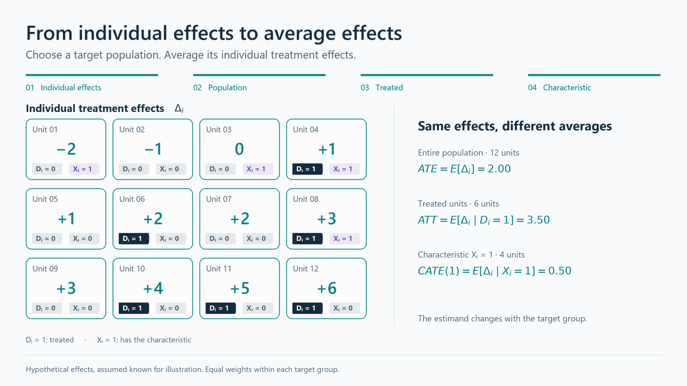

## Causal Parameters of Interest

The previous chapter introduced potential outcomes and the fundamental problem of causal inference. Now that we understand how causal effects are defined, we turn to another important question: **for whom do we want to estimate these effects?**

There is no single treatment-effect parameter that answers every policy question. We may be interested in the effect for the population as a whole, for those who actually received treatment, for units whose treatment status is influenced by a particular assignment rule, or for groups with specific characteristics. These parameters summarize different parts of the treatment-effect distribution and need not have the same value.

The conceptual building block remains the individual treatment effect (ITE) introduced in [Chapter 2](../chapters/02-potential-outcomes.qmd):

$$
\Delta_i = Y_i(1) - Y_i(0).
$$

Although $\Delta_i$ is generally unobservable, it allows us to define causal parameters by averaging individual effects over different target populations. Choosing the appropriate **causal estimand**, that is, the average causal effect for the population or subgroup of interest, is therefore a substantive step that should come before choosing an **estimator**, namely, the statistical procedure used to estimate that effect from the available data.

## The most common causal parameters of interest: ATE and ATT

Because ITEs are generally unobservable, empirical work typically focuses on average causal effects. The broadest of these is the **average treatment effect (ATE)**:

$$
ATE = E[\Delta_i] = E[Y_i(1)-Y_i(0)].
$$

Equivalently,

$$
ATE = E[Y_i(1)] - E[Y_i(0)].
$$

The ATE answers the question: what is the expected effect of the treatment for a randomly selected unit from the population? Using the training program example, the ATE measures the expected effect of the training program for a randomly selected individual from the population.

The most relevant parameter depends on the policy question. The ATE measures the average treatment effect for a specified population. In ex-post policy evaluation, however, we are often more interested in how the program affected **those who actually received it** than in the average effect it would have had if everyone in the population had participated. For this reason, the **average treatment effect on the treated (ATT)** is often the main parameter of interest:

$$
ATT = E[\Delta_i \mid D_i=1].
$$

Equivalently,

$$
ATT = E[Y_i(1) \mid D_i=1] - E[Y_i(0) \mid D_i=1].
$$

The ATT answers the question: what is the average effect of treatment for units that actually received it? Unlike the ATE, which refers to the entire population of interest, the ATT focuses only on the treated units, who represent a subset of that population. Using the training program example, the ATT measures the average effect of the program for individuals who actually participated in it, rather than for all eligible individuals. The ATT is therefore especially useful when evaluating whether a program generated benefits for its participants and, if so, how large those benefits were.

The first component, $E[Y_i(1) \mid D_i=1]$, is observed in the data:

$$
E[Y_i(1) \mid D_i=1] = E[Y_i^{obs} \mid D_i=1].
$$

The second component, $E[Y_i(0) \mid D_i=1]$, is not observed. It is the mean outcome that treated units would have experienced without treatment. Estimating this counterfactual is the central empirical challenge.

::: {.callout-caution appearance="simple"}
### The difficulties in estimating $E[Y_i(0) \mid D_i=1]$

The simplest way to compare treated and untreated units is the **difference-in-means (DIM) estimator**. It is defined as the difference between the average observed outcome of treated units and the average observed outcome of untreated units:

$$
DIM = E[Y_i^{obs} \mid D_i=1] - E[Y_i^{obs} \mid D_i=0].
$$

But, in general,

$$
E[Y_i(0) \mid D_i=1] \neq E[Y_i(0) \mid D_i=0].
$$

The difference

$$
\text{Selection bias} = E[Y_i(0) \mid D_i=1] - E[Y_i(0) \mid D_i=0]
$$

is usually referred to as **selection bias**. Therefore,

$$
DIM = ATT + \text{Selection bias}.
$$

This shows why a simple comparison between treated and untreated units does not generally identify the ATT. The clearest exception is the RCT: as shown in [Chapter 4](../chapters/04-randomized-experiments.qmd), random assignment makes treated and untreated units comparable in expectation, eliminating selection bias. Therefore, the DIM identifies the ATT (which, under random assignment, also equals the ATE).
:::

## Other causal parameters of interest: LATE and ITT

Besides the ATE and ATT, two other causal parameters are especially important in experimental and certain observational designs: the **local average treatment effect (LATE)** and the **intention-to-treat effect (ITT)**.

**The local average treatment effect (LATE)**. The LATE measures the average causal effect for a specific subgroup of units, rather than for the entire population of interest. For example, suppose students automatically receive a scholarship if their test score exceeds a given cutoff. This creates a setting suitable for an RD design (see [Chapter 9](../chapters/09-regression-discontinuity.qmd)), because students just above and just below the cutoff are expected to be very similar, except for scholarship receipt. Under appropriate assumptions, RD identifies the LATE at the cutoff, rather than the average effect for all students. More generally, the subgroup for which a causal effect can be identified depends on the research design and the source of variation in treatment assignment.

**The intention-to-treat effect (ITT)**. ITT measures the effect of being assigned or offered treatment, regardless of whether units actually comply with their assignment.^[The term *compliance* refers to whether units follow their assigned treatment status. For example, some units assigned to treatment may not receive it, while some assigned to the control group may receive it anyway.] It is especially relevant in randomized experiments with imperfect compliance. For policy purposes, the ITT is often meaningful because it captures the effect of implementing an offer, eligibility rule, or assignment mechanism in the real world. For example, suppose a development program randomly offers farmers a voucher for improved seeds and fertilizer, but only some farmers actually redeem the voucher and use the inputs. The ITT compares the average outcomes of farmers who were offered the voucher with those who were not, regardless of actual take-up. It therefore estimates the effect of the policy offer itself, rather than the effect of actually using the improved inputs.

## Conditional average treatment effects

Treatment effects are not necessarily the same for everyone. For example, a training program may be more effective for younger workers than for older ones, while a childcare policy may have stronger employment effects among mothers with young children. Understanding these differences, known as **heterogeneous treatment effects**, is often important for policy evaluation. One way to capture them is through the conditional average treatment effect (CATE):

$$
CATE(x) = E[Y_i(1)-Y_i(0) \mid X_i=x].
$$

The expression "$\mid X_i=x$" means "conditional on unit $i$ having characteristics $x$." In other words, the CATE measures the average treatment effect for units sharing a given set of characteristics, such as firms of a certain size, individuals of a certain age, or regions with a specific pre-treatment unemployment rate. By comparing CATEs across groups, we can identify which types of units benefit more or less from a policy.

Similarly, one can define a conditional ATT (CATT):

$$
CATT(x) =
E[Y_i(1)-Y_i(0) \mid D_i=1, X_i=x].
$$

These conditional parameters are useful because they tell us not only whether a policy works on average, but also for whom it works best. [See Chapter 12 for a deeper discussion.](../chapters/12-heterogeneous_treatment_effects.qmd)

## From Individual Treatment Effects to Average Causal Estimands

The causal estimands discussed in this chapter share a common logic: **they summarize individual causal effects by averaging them over a particular population or subgroup**. To interpret each estimand, we must specify both the intervention whose effect is being evaluated and whose effects enter the average.

For effects of treatment receipt, the building block is $\Delta_i=Y_i(1)-Y_i(0)$. The **ATE** averages these effects over the entire population; the **ATT** over treated units; and the **LATE** for a specific subgroup of units identified by a particular instrument or assignment rule. The **CATE** averages effects among units with specified pre-treatment characteristics, while the **CATT** restricts that average to treated units with those characteristics.^[The **ITT** follows the same averaging logic, but evaluates a different intervention: being assigned or offered treatment, regardless of whether it is actually received. Its building blocks are therefore individual effects of the assignment or offer, rather than the effects of treatment receipt defined by $\Delta_i$.]

The animation below illustrates the aggregation logic for ATE, ATT, and CATE using a hypothetical population of 12 units. Each unit has an individual treatment effect, $\Delta_i=Y_i(1)-Y_i(0)$, a treatment indicator $D_i$, and a binary pre-treatment characteristic $X_i$.
Their individual treatment effects remain fixed; what changes is which units contribute to each average.

::: {.content-visible when-format="html"}

{width="100%"}

:::

::: {.content-visible unless-format="html"}

{width="100%"}

:::

The population ATE is the average of the treatment effects across all 12 units, equal to 2. The ATT averages only the six effects among treated units, yielding 3.5. Finally, CATE(1) averages the four effects among units with $X_i=1$, resulting in 0.5:

$$
ATE=\frac{24}{12}=2,
\qquad
ATT=\frac{21}{6}=3.5,
\qquad
CATE(1)=\frac{2}{4}=0.5.
$$

The CATE subgroup includes both treated and untreated units: it is defined by the characteristic $X_i=1$, not by treatment receipt. The differences between these averages reflect heterogeneous individual treatment effects and different target groups.

In real applications, we observe only one potential outcome for each unit, so we cannot calculate these averages directly from ITEs. Instead, identifying and estimating the causal estimand of interest requires a credible evaluation design and appropriate statistical methods, as discussed in the following chapters.
