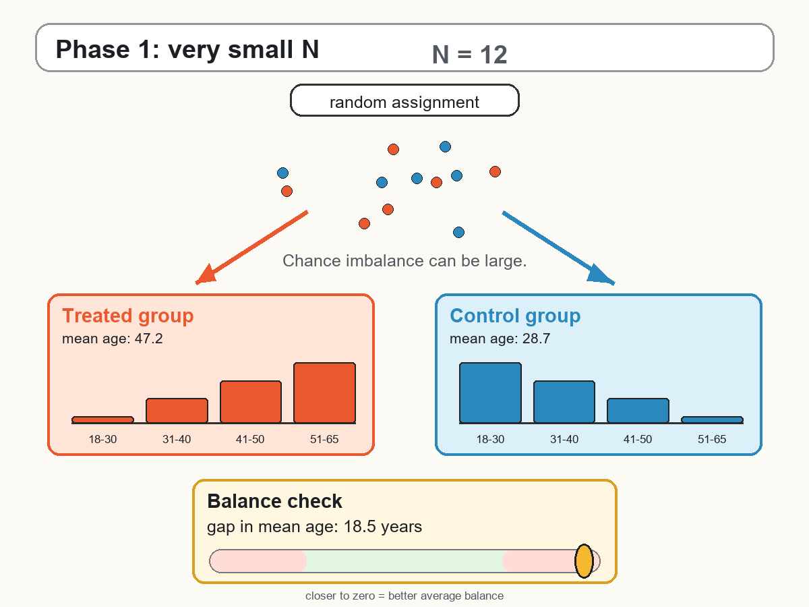
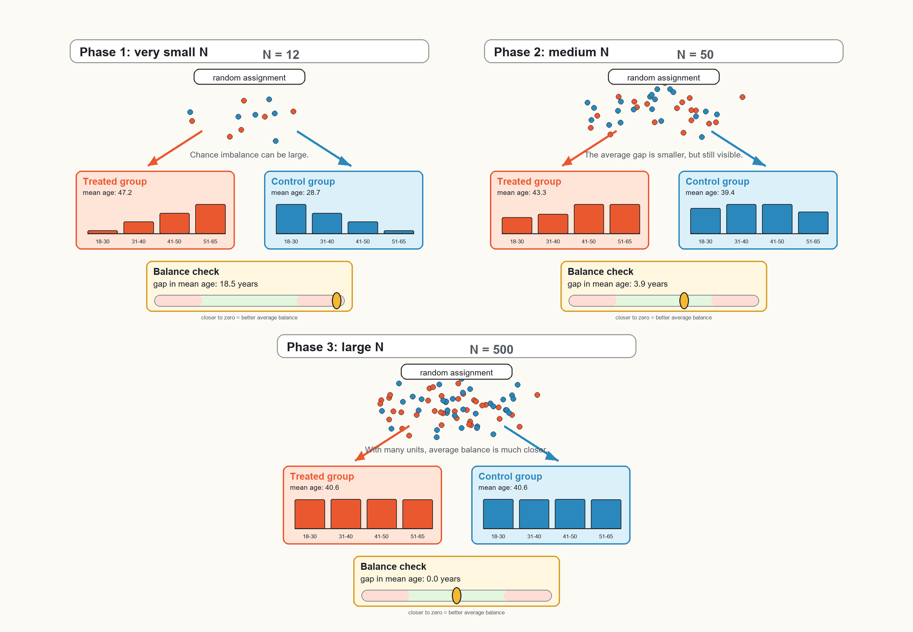

## Randomized Controlled Trials

::: {.content-visible when-format="html"}
^[The two groups have the same mean age in the stylized example with $N=500$. In practice, with finite samples, we should expect some small differences between treated and control groups, although these differences tend to decrease as $N$ increases.]
:::

::: {.content-visible when-format="pdf"}
^[The two groups have the same mean age in the stylized example with $N=500$. In practice, with finite samples, we should expect some small differences between treated and control groups, although these differences tend to disappear as $N$ increases.]
::: 

## What is an RCT?

A **randomized controlled trial (RCT)** is the benchmark research design for causal inference. It is so central to the logic of causal analysis that we have already briefly discussed it in each of the previous chapters. Its logic is simple: if treatment is assigned randomly, treated and untreated units are expected to be similar, on average, before the intervention. Therefore, in a properly implemented RCT, differences in average outcomes between treated and untreated units after the intervention can be attributed to the treatment rather than to systematic pre-existing differences between the two groups.

In the potential outcomes framework, each unit $i$ has two potential outcomes:

$$
Y_i(1)
\quad \text{and} \quad
Y_i(0),
$$

where $Y_i(1)$ is the outcome under treatment and $Y_i(0)$ is the outcome without treatment. The ITE is

$$
\Delta_i = Y_i(1)-Y_i(0).
$$

As discussed earlier, we cannot observe both potential outcomes for the same unit. Randomized experiments solve this problem statistically: they create a treated group and a control group that are comparable in expectation.

::: {.callout-note appearance="simple"}
### Key idea

An RCT creates a credible counterfactual by random assignment.  
The control group tells us what would have happened to the treated group, on average, in the absence of treatment.
:::

### Random Assignment

We begin with a randomized experiment in which all units have the same probability of being assigned to treatment and everyone complies with their assignment. In this setting, treatment receipt $D_i$ coincides with randomized assignment $W_i$. Conceptually, randomization is like flipping a coin: if the probability of treatment is 50%, each unit has an equal chance of being assigned to the treatment or control group. In practice, researchers typically use computer-generated random numbers and may adopt procedures such as stratified or block randomization. The key point, however, is the same: treatment assignment is governed by a known random process, rather than by the choices or characteristics of the units. This implies that treatment status is independent of the potential outcomes:

$$
(Y_i(1),Y_i(0)) \perp D_i.
$$

This condition is crucial. It means that treated and control units do not differ systematically in terms of the outcomes they would have had under treatment or under control. Any difference between the two groups is due only to random sampling variation.

As a result,

$$
E[Y_i(0)\mid D_i=1] = E[Y_i(0)\mid D_i=0],
$$

and

$$
E[Y_i(1)\mid D_i=1] = E[Y_i(1)\mid D_i=0].
$$

The control group can therefore be used to estimate the missing counterfactual outcome for the treated group.

### Estimating the Treatment Effect

In a randomized experiment, the treatment effect can be estimated by comparing the average outcomes of treated and control units:

$$
\widehat{\tau}_{RCT}
=
\overline{Y}^{obs}_{D=1}
-
\overline{Y}^{obs}_{D=0}.
$$

That is, we compare the average observed post-treatment outcome among treated units with the average observed post-treatment outcome among control units.

Because treatment is randomly assigned,^[**Identification vs. estimation.** **Identification** is a population statement: under random assignment, the relevant population averages are exactly equal to the corresponding potential-outcome averages. **Estimation** uses a finite sample to approximate these population quantities, so the corresponding sample averages will generally be only approximately equal because of finite-sample variation. In what follows, we show the key identification result implied by random assignment.]

$$
E[Y_i^{obs}\mid D_i=1] = E[Y_i(1)],
$$

and

$$
E[Y_i^{obs}\mid D_i=0] = E[Y_i(0)].
$$

Therefore, the difference in population means (DIM) estimator identifies the ATE:

$$
DIM
=
E[Y_i^{obs}\mid D_i=1] - E[Y_i^{obs}\mid D_i=0]
=
E[Y_i(1)] - E[Y_i(0)]
=
ATE.
$$

This is the central strength of the randomized design described above: a simple comparison of means identifies the ATE for the experimental population.

::: {.callout-note appearance="simple"}
### Why randomization matters

Without randomization, treated and untreated units may differ even before the intervention, making it difficult to determine whether differences in their outcomes are caused by the treatment or by these pre-existing differences.
Randomization addresses this problem by making the two groups comparable on average, so the average outcome of the control group provides a credible estimate of what would have happened to the treated group without treatment.
:::

### Randomization and Selection Bias

In observational studies, treated and untreated units often differ in their characteristics even before treatment begins. When these differences also affect outcomes, a simple comparison may suffer from selection bias. The difference in population means is

$$
DIM =
E[Y_i^{obs}\mid D_i=1]
-
E[Y_i^{obs}\mid D_i=0].
$$

In general,

$$
DIM = ATT + \text{Selection bias},
$$

where

$$
\text{Selection bias} =
E[Y_i(0)\mid D_i=1]
-
E[Y_i(0)\mid D_i=0].
$$

In a randomized experiment, random assignment implies

$$
E[Y_i(0)\mid D_i=1]
=
E[Y_i(0)\mid D_i=0].
$$

Therefore,

$$
\text{Selection bias} = 0.
$$

This is why randomized controlled trials are often described as the **gold standard** of causal inference: they remove selection bias by design.

::: {.callout-note appearance="simple"}
### Does an RCT identify the ATE or the ATT?

When all units have the same probability of being assigned to treatment and comply with their assignment, the difference in mean outcomes identifies the **ATE for the experimental population**. In practice, the difference between the observed sample means provides an unbiased estimate of this effect.

This is consistent with the result $DIM=ATT$ discussed above. Randomization makes treatment assignment independent of individual treatment effects, so the average effect among treated units equals the average effect in the overall population:

$$
ATT=E[\Delta_i\mid D_i=1]=E[\Delta_i]=ATE.
$$

This population-level equality does not require individual treatment effects to be identical. In a particular random assignment, the average individual effect among the units assigned to treatment may differ by chance from the average across all units in the experiment.
:::

### Treatment and Control Groups

An RCT requires at least two groups:

- a **treatment group**, which receives the intervention;
- a **control group**, which does not receive the intervention.

The control group is not a secondary detail. It is what allows us to approximate the counterfactual outcome: what would have happened to the treated units if they had not received the treatment.

For example, suppose we want to evaluate whether sending households personalized feedback on their energy consumption reduces electricity use. We randomly assign eligible households either to receive the feedback messages or not to receive them. After the intervention, we compare electricity consumption across the two groups. If randomization was successful, the difference in consumption can be interpreted as the average causal effect of the feedback intervention.

### Why Experiments Are Powerful

Randomized experiments are powerful because treatment assignment is under the researcher’s control. Units are assigned to treatment and control groups according to a known random procedure. This avoids a key problem of observational studies: units may self-select into treatment or be selected by policymakers based on characteristics related to their potential outcomes, making treated and untreated groups systematically different even in the absence of treatment.

For instance, people who choose to attend a training course may be more motivated than those who do not. Firms that apply for subsidies may have better growth prospects than firms that do not apply. Neighborhoods receiving a new nursery school may already differ from other neighborhoods in income, demographics, or demand for childcare.

Randomization breaks this link between treatment assignment and potential outcomes because units are assigned to treatment or control before the treatment takes place. It creates treated and untreated groups that are comparable before the treatment, at least in expectation.

::: {.callout-note}
## The Project STAR experiment

One of the largest and most influential RCTs in education is **Project STAR** (*Student/Teacher Achievement Ratio*), conducted in Tennessee in the 1980s. The experiment involved children in the early years of elementary school, from kindergarten through third grade (approximately ages 5–9).

Students and teachers were randomly assigned to different classroom types: small classes, regular-size classes, and regular-size classes with a teacher aide. Because assignment was randomized, differences in later outcomes across these groups can be interpreted as causal effects of the different classroom arrangements, under the usual assumptions of the randomized design.

Project STAR is especially important because it addressed a central question in education policy—whether reducing class size improves student achievement—at a time when rigorous causal evidence on this issue was still limited. The results showed that students assigned to smaller classes performed better on standardized tests, especially in the early grades.

This example illustrates the strength of RCTs. Randomization creates comparable groups before treatment, so the control group provides a credible estimate of what would have happened to students assigned to small classes if they had instead attended regular-size classes.

At the same time, Project STAR also shows that even large RCTs require careful interpretation. Researchers must consider issues such as compliance, attrition, implementation quality (see Section 4.4), and whether the results can be generalized to other schools, states, or education systems (see Section 4.5).
:::

## Historical Intuition

The logic of randomization was developed first in the context of experimental statistics. Fisher’s work on agricultural experiments showed how random assignment could be used to separate the effect of a treatment from background variation in the environment [@fisher1935]. Neyman’s earlier work on potential outcomes also provided a formal way to think about causal effects as comparisons between different possible outcomes for the same unit [@neyman1990].

The idea later became central in medicine. A landmark example is the 1948 randomized trial of streptomycin for pulmonary tuberculosis, conducted by the Medical Research Council in the United Kingdom [@medicalresearchcouncil1948]. Patients were allocated to treatment or control groups using randomization, and outcomes were compared across groups. This design helped establish the RCT as a benchmark for evaluating whether a treatment works.

::: {.callout-note}
## How RCTs transformed medicine

RCTs revolutionized the medical sector because they changed how evidence on treatments is produced. Before RCTs became standard, medical practice often relied on clinical experience, expert judgment, biological reasoning, or uncontrolled comparisons. These sources of knowledge can be valuable, but they can also be misleading when patients receiving a treatment differ systematically from those who do not.

Randomization made it possible to compare treatments in a more credible way. If patients are randomly assigned to a new therapy or to a control condition, differences in health outcomes can be attributed more convincingly to the treatment rather than to pre-existing differences in disease severity, age, lifestyle, or physician choices.

This logic became the foundation of evidence-based medicine. Modern drug approval, clinical guidelines, and many public health recommendations rely heavily on randomized evidence. RCTs also made clear that plausible treatments can fail, and that some treatments believed to be effective may have little benefit or even cause harm.

The broader lesson for impact evaluation is the same: a credible evaluation requires a credible counterfactual. Medicine adopted RCTs because they provide the cleanest ways to construct that counterfactual.
:::

## A/B tests

An **A/B test** is a simple form of randomized experiment, commonly used in digital platforms, marketing, and product design.

Users are randomly assigned to one of two versions of an intervention.^[This is the simplest form of an A/B test, but more complex variants can compare multiple versions (A/B/n testing) or test different combinations of intervention features.] In practice, this randomization is usually implemented automatically by the digital platform: when a user visits the website or opens the app, an algorithm assigns the user to one version or the other, often using a random number generator linked to the user ID.

- **Group A** sees the original version;
- **Group B** sees a modified version.

For example, an online platform may randomly show two versions of a webpage. Version A has the original layout, while version B changes the color or position of a button. The outcome may be the click rate, conversion rate, purchase probability, or time spent on the page.

Because users are randomly assigned to A or B, the difference in average outcomes can be interpreted causally:

$$
\widehat{\tau}_{AB}
=
\overline{Y}^{obs}_{B}
-
\overline{Y}^{obs}_{A}.
$$

The key point is that random assignment makes the two groups highly similar on average before they are exposed to the webpage. Therefore, if version B produces a higher conversion rate, the difference can be attributed to the change being tested, rather than to pre-existing differences between users.

## Threats to Internal Validity

::: {.callout-warning}
### RCTs are not magic

Randomization removes selection bias by design, but the experiment can still be threatened by failed randomization, non-compliance, attrition, behavioral responses, or small samples.
:::

Although randomized experiments are widely regarded as the gold standard for causal inference, random assignment is not enough on its own: other conditions must also be satisfied for the estimated treatment effect to have a credible causal interpretation. Several problems can threaten the **internal validity** of an RCT:^[**Internal validity** refers to the credibility of the causal conclusion within the study: whether the observed difference in outcomes can truly be attributed to the treatment rather than to other factors.]

i) **Failure of Randomization**. Randomization may fail if assignment is not truly random or if the randomization procedure is poorly implemented. For example, assigning units based on surname initials may appear unrelated to the outcome, but it can create imbalances if surname initials are correlated with ethnicity, geography, or socioeconomic status.
A first diagnostic step is therefore to check whether relevant pre-treatment characteristics are balanced across treatment and control groups. More generally, in an RCT treatment status should be assigned through a genuine random procedure, rather than through informal, discretionary, or ad hoc allocation rules.^[A **genuine random procedure** is one in which treatment assignment is determined by chance according to a predefined rule, for example using a random-number generator, a lottery, or another procedure that gives eligible units known probabilities of assignment and leaves no room for discretionary selection.]

ii) **Non-compliance**. A second problem is **non-compliance**. Some units assigned to treatment may not actually receive the treatment, while some units assigned to the control group may gain access to it.
In this case, we must distinguish between being assigned to treatment and actually receiving it.

The effect of assignment is often called the **intention-to-treat effect (ITT)**:

$$
ITT =
E[Y_i^{obs}\mid W_i=1]
-
E[Y_i^{obs}\mid W_i=0],
$$

  where $W_i$ denotes assignment to treatment. The ITT measures the effect of being offered or assigned the treatment, regardless of whether units actually comply. This is particularly relevant for policy evaluation because, in real-world programs, some individuals assigned to treatment may choose not to participate or may be unable to do so. The ITT captures the effect of offering or assigning the program, regardless of actual participation. For example, when evaluating a job training program, policymakers may want to know whether offering training to unemployed workers improves their employment prospects, even if some choose not to participate. The ITT captures this effect, making it particularly useful for assessing the impact of a program as it would be implemented in practice. It should therefore not be confused with the average causal effect of receiving the treatment, which answers a different question.

iii) **Attrition**. Attrition occurs when some units leave the study^[Leaving the study means that participants stop taking part, cannot be contacted, or otherwise become unavailable for follow-up, so researchers cannot observe their outcomes.] before outcomes are measured. Attrition is especially problematic if it is related to treatment status or potential outcomes.
For example, suppose students with lower pre-treatment achievement are more likely to drop out of a schooling experiment. If this selection process is the same in the treatment and control groups and is not itself affected by treatment assignment, randomization can still preserve comparability among the students who remain in the sample. The estimated effect can then remain unbiased for this selected subpopulation, although it no longer necessarily represents the effect for the original experimental population. By contrast, if students who drop out differ systematically between the treatment and control groups, the two groups may no longer be comparable. For example, if lower-performing students are more likely to drop out of the treatment group, the estimated treatment effect may appear more positive than it really is. This is known as attrition bias: the estimated effect may be distorted because we observe outcomes only for a selected group of students rather than for all those originally randomized.

iv) **Behavioral Responses**. Participants may change their behavior simply because they know they are part of an experiment. This is often called the *Hawthorne effect*, named after a series of studies conducted at the Hawthorne Works factory in Cicero, Illinois, where researchers investigated how workers' behavior and productivity responded to changes in working conditions and to being observed. Although the interpretation of these original studies remains debated, the broader concern is that awareness of being studied may influence participants' behavior.
A related problem arises when researchers or administrators know which units receive treatment and consequently behave differently toward treated and control units. In medical trials, double-blind placebo designs are often used to limit these influences by keeping both participants and researchers unaware of treatment assignment.

v) **Small Samples**. Randomization makes treated and control groups comparable on average, but it does not guarantee that they will be similar in every experiment. When the sample is small (for example, only 20 or 30 units in each group), treated and control units may differ substantially by chance in important pre-treatment characteristics.^[There is no universal threshold for what constitutes a small sample, but the fewer units involved, the greater the risk of substantial random imbalances.]
For this reason, even in randomized experiments, researchers often report balance checks to examine pre-treatment differences between groups and may adjust for pre-treatment covariates to improve the precision of their estimates.

Beyond these threats to internal validity, RCTs may also be **infeasible for ethical or economic reasons**. Ethical constraints can make random assignment unacceptable. For example, it would be ethically problematic to randomly deny emergency food assistance to some eligible households after a natural disaster simply to create a control group. RCTs can also be very costly, as they may require recruiting participants, implementing the intervention, monitoring compliance, and collecting outcomes over time. Thus, even when randomization would be ideal for causal identification, ethical, financial, or practical constraints may make it infeasible, requiring researchers to rely on observational designs.

## Threats to External Validity

An experiment may identify the causal effect for a particular population, period, and implementation setting. However, the estimated effect may differ for other populations, periods, or implementation settings.

For example, a recycling campaign tested in one city may not have the same effect in another city with different waste-collection infrastructure or different social norms around recycling. An energy-saving intervention tested among households with smart meters may work less well when scaled up to areas where households do not receive real-time feedback on their electricity consumption.

This is the issue of **external validity**: whether the estimated effect generalizes beyond the experimental setting.^[**External validity** refers to the extent to which a causal effect estimated in a particular study can be expected to apply to other populations, periods, or implementation settings.]

External validity is especially important when RCT evidence is used to guide policy at scale. A trial may be implemented by highly motivated researchers, with careful monitoring, well-trained staff, and selected participants. Once the same intervention is implemented by ordinary institutions, with larger and more heterogeneous populations, the effect may change. For this reason, policymakers should ask not only whether the intervention worked in the experiment, but also whether the mechanisms, incentives, constraints, and implementation capacity are similar in the setting where the policy will be applied.

::: {.callout-warning}
## External validity in medical RCTs

External validity is a central issue in medical RCTs. A drug may be shown to be effective and safe for the population included in a trial, but this does not automatically imply that the same conclusion applies to all potential patients.

Clinical trials often restrict eligibility. They may exclude children, pregnant women, older patients, people with multiple health conditions, or patients taking other medications. These restrictions can improve internal validity and patient safety during the trial, but they also limit the population to which the results directly apply.

This is one reason why some drugs are not recommended, or are not authorized, for children below a certain age. The problem is not necessarily that the drug is known to be ineffective or harmful for those children. Rather, it may be that the drug has not been adequately tested in that age group. Since children differ from adults in body weight, metabolism, development, and possible side effects, evidence from adult trials cannot always be extrapolated safely.
:::

## Summary

In the randomized design considered here, all units have the same probability of treatment assignment and comply with their assignment. Treatment receipt $D_i$ therefore coincides with randomized assignment $W_i$ and is independent of potential outcomes:

$$
(Y_i(1),Y_i(0)) \perp D_i.
$$

This allows the researcher to estimate the ATE for the experimental population using a simple difference in mean outcomes:

$$
\widehat{\tau}_{RCT}
=
\overline{Y}^{obs}_{D=1}
-
\overline{Y}^{obs}_{D=0}.
$$

The main strength of RCTs is that randomization addresses selection bias by design. Their limitations are that they can be difficult or impossible to implement in social science and public policy settings, and that their credibility may still be affected by practical challenges such as non-compliance, attrition, and behavioral responses. Moreover, their findings may not necessarily generalize to other populations or contexts, raising concerns about external validity.
