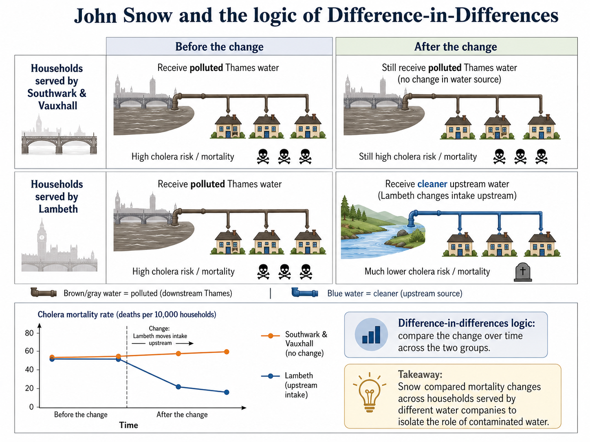
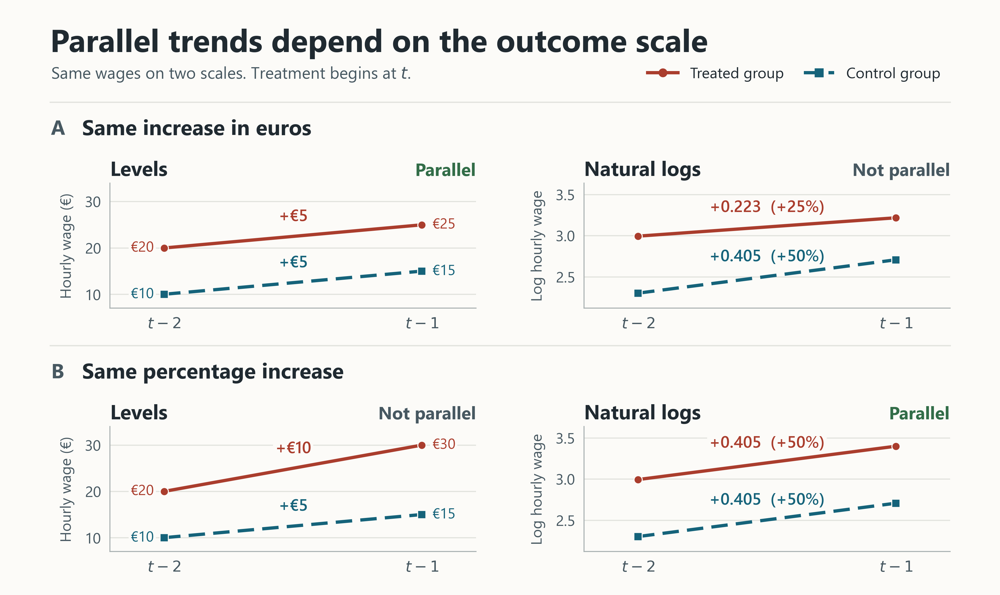
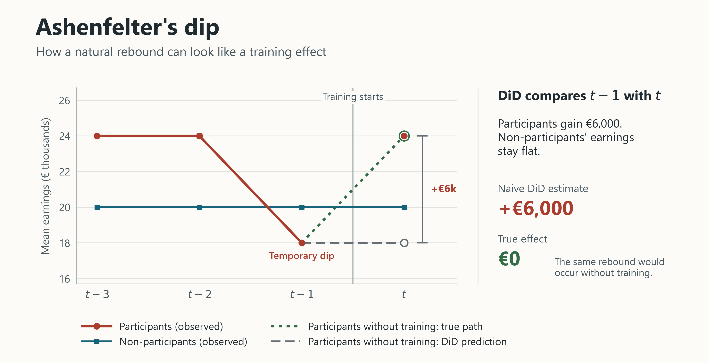
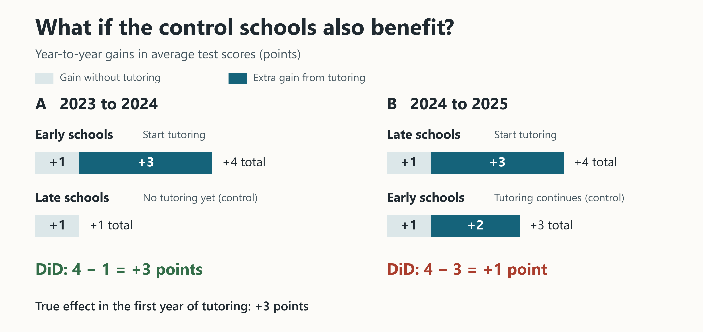

# Difference-in-Differences

::: {.callout-note}
## Difference-in-differences in a figure

:::

Difference-in-differences (DiD) is one of the most widely used research designs in impact evaluation. DiD is particularly suited to settings in which a policy affects one group of units but not another, and both groups are observed before and after the intervention.

The basic idea is simple. We compare the change in the average outcome of the treated group with the corresponding change in the control group over the same period. The first step—calculating the change within each group—eliminates pre-existing differences in outcome levels that remain constant over time. The second step—subtracting the change in the control group from that in the treated group—accounts for shocks and other changes that affect both groups in the same way.

## The Evaluation Problem

Suppose there are two groups: a treated group and a control group. We observe both groups in two periods:

- a pre-treatment period, before the policy starts;
- a post-treatment period, after the policy starts.

Let $D_i=1$ for units in the treated group and $D_i=0$ for units in the control group. Let $Post_t=1$ in the post-treatment period and $Post_t=0$ in the pre-treatment period.

The target parameter is usually the ATT in the post-treatment period:

$$
ATT = E[Y_{i,post}(1)-Y_{i,post}(0)\mid D_i=1].
$$

The problem is familiar: for treated units after the policy, we observe $Y_{i,post}(1)$, but we do not observe $Y_{i,post}(0)$. We need to estimate what would have happened to the treated group in the absence of treatment.

DiD uses the change observed in the control group as an estimate of the counterfactual change that the treated group would have experienced without treatment.

::: {.callout-note appearance="simple"}
### Key idea

DiD does not require treated and control groups to have the same average outcome before treatment. Instead, it requires that, in the absence of treatment, their average outcomes would have changed in the same way over time.
:::

## Historical Intuition

An early example of DiD logic can be found in John Snow's analysis of cholera in nineteenth-century London [@snow1855]. At the time, cholera was often explained by the dominant miasma theory, according to which disease spread through “bad air.” Snow instead argued that cholera was transmitted through contaminated water, but he needed empirical evidence to support his theory.

The empirical setting was unusually informative. In parts of London, households were served by different water companies. Before the relevant change, both the Lambeth Company and the Southwark & Vauxhall Company drew water from polluted sections of the River Thames. Later, Lambeth moved its water intake upstream,^[Lambeth had moved its water intake upstream in 1852 to improve water quality, relocating it beyond the main influence of London’s sewage. This change provided the crucial variation Snow exploited to test the waterborne-transmission hypothesis.] to a cleaner part of the river, while Southwark & Vauxhall continued to draw water from a more contaminated downstream source.

This setting allowed for two comparisons: **over time**, before and after the change in water supply, and **across groups**, between households served by Lambeth and those served by Southwark & Vauxhall. The key question was whether cholera mortality declined more among households served by Lambeth, which switched to cleaner water, than among households served by Southwark & Vauxhall, which did not. A greater decline in mortality among Lambeth households would provide evidence that access to cleaner water reduced cholera mortality.

{width=85%}

This example illustrates the logic of the traditional DiD design. Households served by Lambeth constitute the treated group because their water supply became cleaner, while those served by Southwark & Vauxhall constitute the control group because they remained exposed to polluted water. The key question is not simply whether cholera mortality was lower among Lambeth households after the change, but whether it declined **more** among these households than among those whose water supply remained unchanged.

In economics, classic applications include Card's study of the Mariel Boatlift and the Miami labor market [@card1990], and Card and Krueger's study of the employment effects of the 1992 minimum wage increase in New Jersey relative to Pennsylvania [@card1994].

## The Basic DiD Estimator

With two groups and two periods, the DiD estimator is

$$
\widehat{\tau}_{\text{DiD}}
=
\left(\bar{Y}_{1,\text{post}}-\bar{Y}_{1,\text{pre}}\right)
-
\left(\bar{Y}_{0,\text{post}}-\bar{Y}_{0,\text{pre}}\right).
$$

The causal estimand of interest is the ATT. Here, $\bar{Y}_{1,\text{post}}$ and $\bar{Y}_{1,\text{pre}}$ denote the average outcomes of the treated group in the post-treatment and pre-treatment periods, respectively, while $\bar{Y}_{0,\text{post}}$ and $\bar{Y}_{0,\text{pre}}$ denote the corresponding averages for the control group.

This can also be written as

$$
\widehat{\tau}_{\text{DiD}}
=
\left(\bar{Y}_{1,post}-\bar{Y}_{0,post}\right)
-
\left(\bar{Y}_{1,pre}-\bar{Y}_{0,pre}\right).
$$

These two expressions are algebraically equivalent. The first emphasizes changes over time within each group. The second emphasizes how the treated-control gap changes after treatment.

## The Parallel Trends Assumption

The central identifying assumption is the **parallel-trends assumption**. It states that, in the absence of treatment, the treated and control groups would have experienced the same average change in outcomes. Formally,

$$
E[Y_{i,post}(0)-Y_{i,pre}(0)\mid D_i=1]
=
E[Y_{i,post}(0)-Y_{i,pre}(0)\mid D_i=0].
$$

This assumption allows the control-group trend to stand in for the missing untreated trend of the treated group.

Under parallel trends,

$$
E[Y_{i,post}(0)\mid D_i=1]
=
E[Y_{i,pre}(0)\mid D_i=1]
+
E[Y_{i,post}(0)-Y_{i,pre}(0)\mid D_i=0].
$$

In words, the counterfactual post-treatment outcome for the treated group is obtained by taking its pre-treatment outcome and adding the change observed in the control group.^[In addition to parallel trends, identifying the ATT requires the **no-anticipation** assumption and **SUTVA**, both introduced in Chapter 2.]

<!--Importantly, the parallel trends assumption cannot be fully tested. We cannot observe how treated units would have evolved after the intervention in the absence of treatment. What we can check is whether treated and untreated units followed similar trends before the intervention, using pre-treatment outcomes as indirect evidence in support of the assumption.
-->
::: {.callout-warning}
### Parallel trends is about counterfactual trends

The parallel trends assumption does not require treated and control groups to have the same average outcome before treatment. It requires that, in the absence of treatment, their average outcomes would have changed by the same amount over time. Crucially, this assumption concerns what would have happened without treatment, not necessarily what we observe after treatment.
:::

::: {.content-visible when-format="html"}

{width="100%"}

:::

::: {.content-visible when-format="pdf"}

{width="100%"}

:::

## Regression Form

The two-period DiD estimator can also be obtained from the following regression:

$$
Y_{it} = \alpha + \beta D_i + \gamma Post_t + \tau_{\text{DiD}} (D_i \times Post_t) + \varepsilon_{it}.
$$

Here, $D_i$ equals 1 for units in the treated group and 0 for units in the control group, while $Post_t$ equals 1 in the post-treatment period and 0 in the pre-treatment period.^[Note that, in this setting, $D_i$ does not vary over time: it indicates group membership rather than whether a unit is receiving treatment in a given period.] The interaction term $D_i \times Post_t$ therefore equals 1 only for treated units in the post-treatment period and 0 otherwise.

Under the identifying assumptions of DiD, the estimated coefficient $\widehat{\tau}_{\text{DiD}}$ provides an estimate of the ATT. In the simple two-group, two-period case, this coefficient is numerically equivalent to the traditional DiD estimator:

$$
\widehat{\tau}_{\text{DiD}}
=
\left(\bar{Y}_{1,\text{post}}-\bar{Y}_{1,\text{pre}}\right)
-
\left(\bar{Y}_{0,\text{post}}-\bar{Y}_{0,\text{pre}}\right).
$$

The regression coefficients have a straightforward interpretation:

- $\alpha$ represents the average outcome of the control group before the policy ($5$ in the example);
- $\beta$ represents the difference in average outcomes between the treated and control groups before the policy ($10-5=5$);
- $\gamma$ represents the change in the average outcome of the control group from the pre-treatment to the post-treatment period ($8-5=3$). Under the parallel trends assumption, this is also the change that the treated group would have experienced in the absence of the policy;
- $\tau_{\text{DiD}}$ represents the additional change in the average outcome of the treated group relative to the control group ($(17-10)-(8-5)=4$). Under the identifying assumptions of DiD, this coefficient captures the ATT.

Why use a regression model if the DiD estimate can be obtained simply by calculating differences between four means? One of the main advantages of the regression framework is that it facilitates statistical inference. Rather than providing only a point estimate of the treatment effect, it allows us to compute standard errors and confidence intervals for $\widehat{\tau}_{\text{DiD}}$ and to test hypotheses about the underlying causal effect, $\tau_{\text{DiD}}$.

Moreover, the regression framework makes it easier to extend the basic DiD design, for example by including covariates or accommodating multiple time periods, as we will see in the following sections.

## Covariates and Conditional Parallel Trends

The basic DiD regression model can be extended to account for observed pre-treatment characteristics that help explain how outcomes would have evolved in the absence of treatment. This may improve precision and support a conditional parallel-trends assumption when unconditional parallel trends is implausible.

Consider a two-period panel in which the same units are observed before and after treatment. Let $X_i$ denote a vector of observed characteristics measured before treatment. We use the same pre-treatment values in both periods, even if the characteristics themselves subsequently change. An extended regression specification is

$$
Y_{it}
=
\alpha
+
\beta D_i
+
\gamma Post_t
+
\tau_{\text{DiD}}(D_i \times Post_t)
+
X_i'\delta
+
Post_t \times X_i'\theta
+
\varepsilon_{it}.
$$

The two additional terms serve different purposes:

- $X_i'\delta$ allows units with different pre-treatment characteristics to have different outcome levels.
- $Post_t \times X_i'\theta$ allows units with different pre-treatment characteristics to experience different changes in outcomes over time.

The second term is particularly important in a DiD design. Simply including pre-treatment covariates accounts for differences in outcome levels, but not for differences in outcome changes associated with these characteristics. Interacting the covariates with $Post_t$ addresses this distinction. In this specification, differences in untreated outcome changes are modeled as linear functions of the covariates, with the same coefficients for treated and untreated units.

To see why this matters, suppose we are evaluating the effect of a subsidy on firms' employment. Even in the absence of the subsidy, large firms may tend to experience larger increases in employment than small firms. If subsidized firms are generally larger than unsubsidized firms, the two groups may therefore have followed different employment trends even without the policy. By allowing pre-treatment firm size to explain differences in employment growth, rather than just differences in employment levels, we may construct a more credible counterfactual.

Importantly, we do not control for firm size measured after the intervention. We use firm size measured before the subsidy and allow its relationship with employment to differ between periods. Controlling for post-treatment firm size could introduce bias because firm size may itself be affected by the subsidy.

The logic becomes particularly clear when we express the model in first differences. Subtracting the pre-treatment equation from the post-treatment equation gives

$$
\Delta Y_i
=
\gamma
+
\tau_{\text{DiD}}D_i
+
X_i'\theta
+
\Delta\varepsilon_i,
$$

where $\Delta Y_i=Y_{i,\text{post}}-Y_{i,\text{pre}}$. The time-invariant terms, including $X_i'\delta$, disappear.The model therefore compares changes in outcomes between treated and untreated units while accounting for pre-treatment characteristics that may influence how outcomes evolve over time in the absence of treatment.

The underlying identifying assumption is **conditional parallel trends**: in the absence of treatment, treated and untreated units with the same observed pre-treatment characteristics would have experienced the same average change in outcomes. Formally,

$$
E[Y_{i,\text{post}}(0)-Y_{i,\text{pre}}(0)\mid D_i=1,X_i]
=
E[Y_{i,\text{post}}(0)-Y_{i,\text{pre}}(0)\mid D_i=0,X_i].
$$

This assumption allows untreated outcome trends to differ across covariate values, but not between treated and untreated units with the same covariate values.

Under conditional parallel trends, no anticipation, no interference, and sufficient common support^[As in matching methods, *common support* requires that treated units have comparable untreated units in terms of their observed pre-treatment characteristics. Without common support, estimating the missing counterfactual changes for treated units would require extrapolation.], outcome changes among comparable untreated units identify the average counterfactual changes for treated units with the same characteristics. By comparing these counterfactual changes with the observed changes among treated units and averaging the resulting differences over the treated population, we can identify the ATT.

::: {.callout-warning appearance="simple"}
### Avoid post-treatment covariates

In DiD, covariates should be measured before treatment and their pre-treatment values should be used throughout the analysis. Controlling for characteristics measured after treatment may introduce bias if these characteristics are themselves affected by the intervention.
:::

## Diagnostics and Validity Checks

The parallel-trends assumption is fundamentally about an unobserved counterfactual, so it cannot be tested directly. However, if at least two pre-treatment periods are available, its plausibility can be assessed indirectly by examining whether treated and control units followed similar trends before the treatment. If treated and control groups move very differently before treatment, the parallel-trends assumption becomes less credible.

With several pre-treatment periods, researchers can estimate placebo DiD effects using periods before the treatment actually occurred. If the method finds large **pre-treatment placebo estimates**, this raises the concern that part of the estimated effect may be driven by differences in trends that were already present before treatment.

Other useful checks include:

- plotting average outcomes for treated and control groups over time, rather than only the differences between them;
- checking sensitivity to alternative comparison groups (if available);
- checking whether the estimated effect changes when adding relevant pre-treatment covariates;
- checking whether other policies or shocks occurred at the same time.

::: {.callout-caution appearance="simple"}
### Pre-trends are informative, not definitive

Similar pre-treatment trends support the credibility of a DiD design, but they do not prove that counterfactual trends would have remained parallel after treatment, since this assumption is not fully testable. Conversely, diverging pre-treatment trends should be viewed as a strong warning sign.
:::

## Functional Form Limitation

Parallel trends can depend on the scale of the outcome. Parallel trends in levels do not automatically imply parallel trends in logs^[Researchers often use the natural logarithm (logarithm to base $e$) of an outcome because changes in natural logs, multiplied by 100, approximately represent percentage changes rather than absolute changes (this approximation is accurate for small percentage changes but becomes less accurate as the magnitude of the change increases). For example, two firms of different sizes may experience similar percentage increases in employment but very different increases in the number of employees. Logarithmic transformations may also reduce the influence of extremely large outcome values.], and parallel trends in logs do not automatically imply parallel trends in levels.

To see why, consider two examples of hourly wage growth before treatment (@fig-did-levels-vs-logs):

- **Same increase in euros (A).** Wages rise by €5 per hour in both groups: from €20 to €25 (+25%) in the group that will be treated and from €10 to €15 (+50%) in the control group. The trends are parallel in levels but not in logs.
- **Same percentage increase (B).** Wages rise by 50% in both groups. This is a €10 increase in the group that will be treated and a €5 increase in the control group. The trends are parallel in logs but not in levels.

{#fig-did-levels-vs-logs width="100%" fig-alt="Four line plots show that equal euro increases yield parallel trends only in levels, while equal percentage increases yield parallel trends only in logs."}

The scale matters for both the identifying assumption and the quantity we estimate. A DiD in levels targets an effect on hourly wages in euros, whereas a DiD in logs targets an effect on log hourly wages. The pre-treatment patterns in the figure illustrate the difference between the two scales.

This is why the choice between levels, logs, and other transformations should be substantive rather than mechanical, and ideally made before examining the results to avoid *cherry-picking*^[In empirical research, *cherry-picking* refers to selectively choosing specifications or results that support a desired conclusion while disregarding those that do not. This practice can produce misleading evidence about the effect of a policy.] the specification that produces the most favorable estimate.

## Worked Example

Suppose a public subsidy for workplace safety is introduced in one region but not in a neighboring region. The policy starts in 2024 and aims to reduce workplace accidents.

A DiD evaluation would compare:

- the change in accident rates in the treated region before and after 2024;
- the change in accident rates in the control region over the same period.

The estimator is

$$
\widehat{DiD}
=
\left(\bar{Y}_{treated,after}-\bar{Y}_{treated,before}\right)
-
\left(\bar{Y}_{control,after}-\bar{Y}_{control,before}\right).
$$

If workplace accidents fall by 5 per 1,000 workers in the treated region and by 1 per 1,000 workers in the control region, the DiD estimate is

$$
-5 - (-1) = -4.
$$

The interpretation is that the subsidy reduced accidents by 4 per 1,000 workers, provided that the treated and control regions would have followed parallel trends in the absence of the policy.

**A note of caution.** This interpretation would be less credible if accidents were already declining faster in the treated region before the policy, or if another safety regulation was introduced only in the treated region at the same time.

## Ashenfelter's Dip

A classic threat to DiD is **Ashenfelter's dip** [@ashenfelter1978]. This occurs when units select into treatment after experiencing a temporary negative shock.

Suppose workers enter a training program after a sudden fall in earnings. Even without the program, their earnings might partially or fully recover. A DiD estimator comparing these workers with non-participants may mistakenly attribute the natural rebound to the training program.

The problem is that treatment timing is related to a temporary shock in the untreated potential outcome. A simple DiD design differences out time-invariant unobserved heterogeneity, not temporary shocks that affect treatment participation.

In @fig-did-ashenfelter-dip, participants' average earnings fall from €24,000 to €18,000 just before training and then recover to €24,000. Because non-participants' earnings stay flat, a DiD that uses the dip as its baseline predicts that participants would have stayed at €18,000 without training (gray dashed line). The resulting estimate is **+€6,000**, even though the true effect in this example is **zero**: participants would have recovered to €24,000 without training (green dotted line).

{#fig-did-ashenfelter-dip width="100%" fig-alt="Participants' earnings fall from 24,000 to 18,000 euros just before training and then return to 24,000 euros, while non-participants' earnings stay flat. DiD predicts no rebound and estimates an effect of 6,000 euros, but the true effect is zero because the same rebound would have occurred without training."}

Longer panels can help diagnose this problem. If outcomes fall sharply just before treatment and then recover, the estimated effect may capture mean reversion rather than a causal effect. The pre-treatment placebo tests discussed above can help detect an Ashenfelter's dip by revealing whether the treated group's outcome declined unusually just before treatment.

## A DiD Extension: The Triple Differences Estimator

The **triple differences (DDD) estimator** extends DiD by adding a third dimension of comparison [@olden2022].

Suppose a parental leave reform is introduced in some states but not others and applies only to mothers. We want to estimate its effect on mothers' employment. A standard DiD would compare changes in mothers' employment between states that introduce the reform and states that do not. However, this comparison may be misleading if employment would have evolved differently across the two groups of states even in the absence of the reform.

A possible solution is to introduce an additional comparison group: fathers. If fathers are unaffected by the reform, a DiD comparing their employment changes across the same states can help us account for differences in employment trends that are unrelated to the reform but common to mothers and fathers.

The triple differences estimator is therefore the difference between two DiD estimates:

$$
DDD = DiD_{\text{mothers}} - DiD_{\text{fathers}}.
$$

The intuition is simple: if the DiD estimates for mothers and fathers suffer from the same bias due to differences in employment trends across states, subtracting the second estimate from the first removes this bias.

DDD therefore relies on a different version of the **parallel-trends assumption**: in the absence of the reform, the difference in employment between mothers and fathers would have evolved in the same way in treated and control states. Importantly, this assumption does not require mothers in treated and control states to have parallel trends, nor does it require fathers to have parallel trends. It requires that any differences in trends across states be the same for mothers and fathers.

Under this assumption, together with the other identifying assumptions of DiD and provided that fathers are unaffected by the reform, the DDD estimator identifies the ATT for mothers.

## Matching Difference-in-Differences

Matching DiD combines the logic of matching with the logic of DiD. It is useful when treated and control units differ in observed characteristics, but panel or repeated cross-sectional data are available.^[**Repeated cross-sectional data** consist of samples drawn from the same population at different points in time. For example, a survey may collect information on a different sample of households each year. Unlike panel data, repeated cross-sectional data do not follow the same units over time.]

The matching step makes treated and control units more comparable in terms of observed pre-treatment covariates. The DiD step then accounts for the influence of unobserved characteristics whose effects on the outcome remain constant over time.

A key contribution to this literature is Heckman, Ichimura, and Todd [@heckman1997].

For the two-period case, a matching DiD estimator for the ATT can be written as

$$
\widehat{ATT}_{MDID}
=
\frac{1}{N_T}
\sum_{i:D_i=1}
\left[
(Y_{i,post}-Y_{i,pre})
-
\sum_{j:D_j=0}w_{ij}(Y_{j,post}-Y_{j,pre})
\right],
$$

where $w_{ij}$ is the weight given to control unit $j$ when constructing the counterfactual trend for treated unit $i$.

Matching DiD relies on the conditional parallel trends and common support assumptions introduced above. The matching step helps make these assumptions more plausible by constructing a comparison group of untreated units with similar pre-treatment characteristics.

Matching can strengthen a DiD design by constructing a more comparable control group before estimating the treatment effect. To fully benefit from this approach, researchers should carefully select matching variables that are relevant to the evolution of the outcome and are not affected by treatment or its anticipation. It is also important to retain enough informative control units to ensure adequate precision. The quality of the resulting comparison should be assessed by checking common support, covariate balance, and, especially, the similarity of pre-treatment outcome trends after matching. These diagnostics help establish whether matching has made the parallel trends assumption more plausible and the resulting DiD estimates more credible.

::: {.callout-note appearance="simple"}
### Matching DiD

Matching DiD controls for observed differences through matching and for time-invariant unobserved differences through differencing.
:::

## TWFE With Staggered Adoption

In the canonical DiD setting, there are two groups and two periods: one group becomes treated, the other remains untreated, and the DiD estimand compares the change in outcomes for the treated group with the change in outcomes for the control group. In such a simple setting, the DiD parameter has a transparent interpretation: it estimates the ATT under the parallel-trends assumption.

However, many empirical applications are more complex because units adopt the treatment at different points in time. Some units receive treatment earlier, others later, and some may never receive it. This setting is known as **staggered adoption**. In this case, the causal effects of interest are often **group-time average treatment effects**, usually denoted as $ATT(g,t)$. These parameters measure the average effect of the treatment at time $t$ for the group of units first treated in period $g$.

For example, $ATT(g,t)$ asks: among units first treated in period $g$, what is the average difference at time $t$ between their observed outcome under treatment and the outcome they would have experienced if they had not yet been treated?

For many years, the standard empirical approach in staggered-adoption settings was to estimate a **two-way fixed effects (TWFE)** model:

$$
Y_{it}
=
\alpha_i
+
\lambda_t
+
\tau_{\text{TWFE}} D_{it}
+
X_{it}'\beta
+
u_{it}.
$$

Here, $\alpha_i$ are unit fixed effects, which absorb time-invariant differences across units. The terms $\lambda_t$ are time fixed effects, which absorb shocks common to all units in a given period.^[In practice, **fixed effects** can be thought of as sets of dummy variables. Unit fixed effects allow each unit to have its own baseline outcome level, accounting for differences across units that remain constant over time. Time fixed effects allow each period to have its own outcome level, accounting for changes over time that are common to all units.] The variable $D_{it}$ is time varying and indicates whether unit $i$ is treated at time $t$. The coefficient $\tau_{\text{TWFE}}$ is often interpreted as the ATT.

::: {.callout-note appearance="simple"}
### TWFE application: unilateral divorce laws and dynamic effects

Wolfers [-@wolfers2006] studies whether the staggered adoption of **unilateral divorce laws** raised divorce rates in the United States. Between 1968 and 1988, 29 states changed their divorce laws at different times. A natural static TWFE specification is

$$
DivorceRate_{st}
=
\alpha_s
+
\lambda_t
+
\tau_{\text{TWFE}} Unilateral_{st}
+
u_{st},
$$

where state fixed effects $\alpha_s$ absorb permanent differences across states, year fixed effects $\lambda_t$ absorb common national shocks, and $Unilateral_{st}$ indicates whether unilateral divorce was available in state $s$ and year $t$. The coefficient $\tau_{\text{TWFE}}$ compresses the effects observed at all post-reform horizons into a single estimate.

This restriction is consequential because the effect was not constant over time. In Wolfers's dynamic specification, divorce rates increased by approximately **0.27 divorces per 1,000 people** during the first two years after reform and by **0.22** during years three and four. The estimated increase then became smaller, and by years nine and ten the estimate was approximately **-0.10**, providing no evidence of a persistent positive effect.
:::

However, in staggered-adoption designs, $\tau_{\text{TWFE}}$ does not generally identify the ATT. Instead, it combines multiple DiD comparisons across groups and time periods. Some of these comparisons use never-treated or not-yet-treated units as controls, which is consistent with the traditional logic of DiD. Others, however, use already-treated units as controls for newly treated units. The latter comparisons can be particularly problematic when treatment effects evolve over time: changes in outcomes among already-treated units may themselves reflect the effects of treatment, rather than how outcomes would have evolved in its absence. As a result, even when the parallel trends assumption holds, the TWFE estimator does not generally identify the ATT in staggered-adoption designs if treatment effects vary across groups or over time.

::: {.callout-warning}
### Why TWFE needs caution

With staggered treatment timing and heterogeneous treatment effects, a TWFE coefficient may not estimate the policy-relevant ATT.
:::

Therefore, the TWFE coefficient $\tau_{\text{TWFE}}$ should not be interpreted as having the same causal meaning as the DiD estimand in the simple two-group, two-period design. Even when the parallel trends assumption holds, the TWFE coefficient may combine different group-time average treatment effects, $ATT(g,t)$, using weights that are difficult to interpret and may even be negative. When treatment effects vary across groups or over time, the resulting estimate may therefore differ substantially from the ATT and lead to misleading conclusions [@dechaisemartin2020; @goodmanbacon2021; @callaway2021; @sun2021; @imai2021].

::: {.callout-warning}
## Forbidden comparisons

Imagine two groups of schools introduce a tutoring program at different times: one group starts in 2024, while the other starts in 2025. Suppose that, without tutoring, average test scores would increase by one point per year in both groups. The program has a growing effect: it increases test scores by three points in the first year and by five points in the second year, relative to what scores would have been without tutoring.

@fig-did-forbidden-comparisons illustrates what happens when we use each group in turn as the control group for the other:

- **2024: using not-yet-treated schools as controls.** Average test scores increase by four points in the schools that introduce tutoring: one point due to the underlying trend and three points due to the program. In the schools that have not yet introduced tutoring, scores increase by only one point. The DiD estimate correctly recovers the treatment effect: $4-1=3$.

- **2025: using already-treated schools as controls.** Average test scores increase by four points in the schools that introduce tutoring in 2025. The schools used as controls are now in their second year of tutoring. Their scores rise by three points: one point they would have gained anyway and two more because the tutoring effect grows from three to five points. The DiD estimate is therefore $4-3=1$, even though the program increases test scores by three points in the newly treated schools.

The second comparison is **forbidden** because the change in outcomes among the control schools no longer reflects only what would have happened without treatment. It also captures the growth of their own treatment effect. In this example, subtracting the control schools' gain makes the DiD estimate two points too small.

{#fig-did-forbidden-comparisons width="100%" fig-alt="In 2024 the schools starting tutoring gain four points and schools with no tutoring yet gain one, so DiD recovers the three-point effect. In 2025 the schools starting tutoring gain four points and the schools used as controls gain three, including two extra points from tutoring. DiD estimates one point instead of three."}
:::

In recent years, several estimators have been proposed as alternatives to the standard TWFE model, particularly in settings with staggered treatment adoption and heterogeneous treatment effects. These methods address the limitations of TWFE by avoiding forbidden comparisons, allowing treatment effects to vary across cohorts and over time, and providing more transparent ways of aggregating these effects into meaningful causal estimands. They are often discussed within the broader **event-study** literature because they allow researchers to examine how treatment effects evolve after treatment adoption and to assess pre-treatment trends. We will discuss these methods in [Chapter 7](../chapters/07-event-studies.qmd).

<!--## PanelMatch

PanelMatch is a non-parametric generalization of matching DiD for time-series cross-sectional data [@imai2023].

The method constructs matched sets for treated observations using the treatment, outcome, and covariate histories observed before treatment. The basic logic is:

1. Identify treated unit-periods.
2. Find control unit-periods with similar pre-treatment histories.
3. Weight the control observations using matching or weighting methods.
4. Estimate the counterfactual outcome for treated observations.
5. Average the resulting treatment effects over treated observations and horizons.

PanelMatch is especially useful when units can switch treatment status over time or when treatment effects may evolve dynamically. It also makes diagnostics more transparent because the researcher can inspect balance in lagged outcomes and covariates.

The method still requires assumptions: limited carryover, no interference, and conditional parallel trends after conditioning on treatment, outcome, and covariate histories.

An example is the study by Acemoglu, Naidu, Restrepo, and Robinson on the effect of democracy on economic growth, which uses panel methods including matching DiD-style comparisons [@acemoglu2019].
-->

## Summary

DiD estimates the ATT by comparing changes in average outcomes over time between treated and control groups.

Its main strength is that it accounts for persistent differences between groups and shocks that affect both groups in the same way. Its main limitation is that it relies on the **parallel trends assumption**, which requires that, in the absence of treatment, the average outcomes of treated and control groups would have changed by the same amount over time. Crucially, this assumption cannot be tested directly.

In the simple two-group, two-period setting, DiD is transparent and intuitive. In more complex settings with staggered treatment adoption and heterogeneous treatment effects, additional challenges arise, requiring more sophisticated estimators, as discussed in the next chapter.

::: {.callout-note appearance="simple"}
## Software packages

Basic DiD can be implemented using standard regression tools. In the simplest two-group, two-period case, this usually means estimating a linear regression with a treatment indicator, a post-treatment indicator, and their interaction.

- **R**
  - [`lm`](https://stat.ethz.ch/R-manual/R-devel/library/stats/help/lm.html): the base R function for estimating linear regression models, including simple DiD specifications.
  - [`fixest`](https://cran.r-project.org/package=fixest): a fast package for linear models with fixed effects, useful for DiD specifications with unit and time fixed effects.

- **Python**
  - [`statsmodels`](https://www.statsmodels.org/): a general statistical modeling library that can estimate DiD regressions using OLS and formula syntax.
  - [`linearmodels`](https://bashtage.github.io/linearmodels/): a package for panel-data models, including fixed-effects regressions useful for standard DiD applications.

- **Stata**
  - [`regress`](https://www.stata.com/manuals/rregress.pdf) (`reg`): the standard OLS command, which can be used for simple DiD regressions.
  - [`xtreg, fe`](https://www.stata.com/manuals/xtxtreg.pdf): Stata's fixed-effects panel regression command.
  - [`reghdfe`](https://scorreia.com/help/reghdfe.html): a widely used user-written command for regressions with multiple fixed effects and clustered standard errors.
:::
