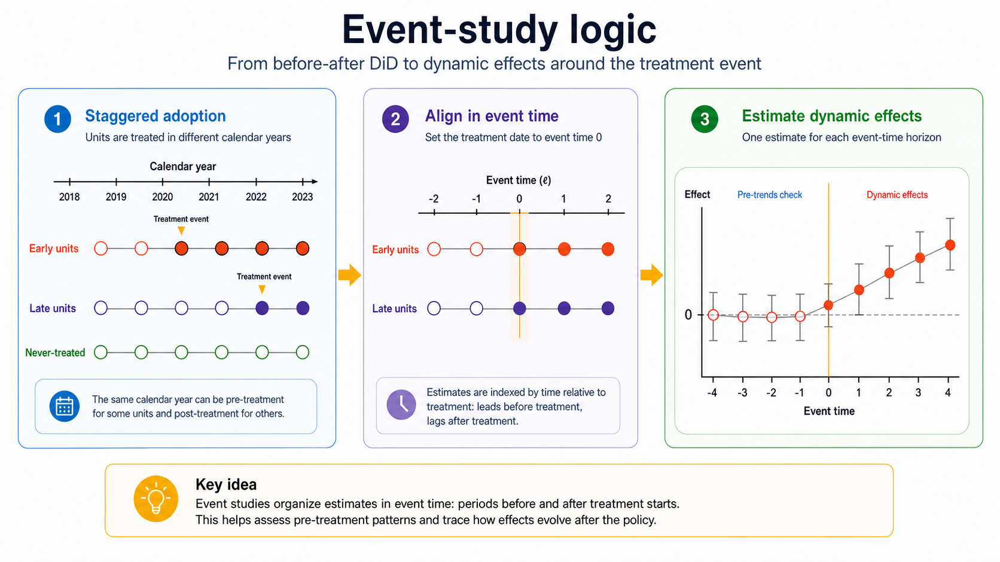
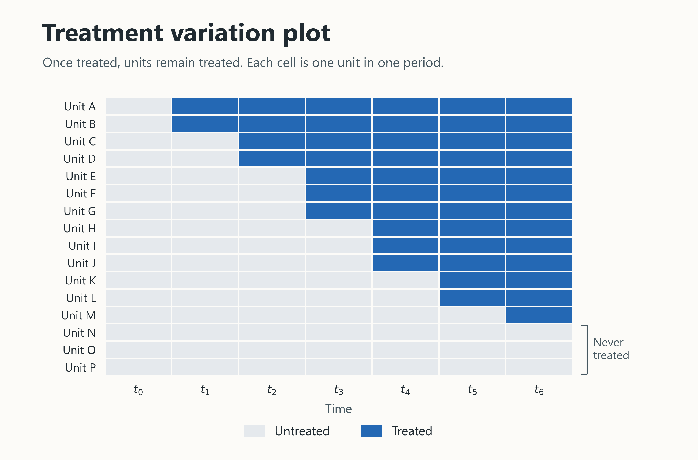

# Event Studies

The canonical DiD design compares treated and control units over two periods: one before treatment and one after treatment. But many real policy settings are richer. Units may receive treatment at different times, and researchers may want to understand not only whether a policy had an effect, but also **when** its effects emerged and how they evolved over time.

This is the main motivation for **event-study designs**. In this chapter, the term event study refers to modern DiD-based approaches that estimate treatment effects relative to the timing of an event, such as the introduction of a policy or the occurrence of an unexpected shock.^[The term **event study** is also used differently in other fields. In finance, for example, traditional event studies typically measure abnormal stock returns around a specific event by comparing observed returns with the returns predicted by a model of normal market performance. This differs from the DiD-based event-study designs discussed here, which compare outcome dynamics across groups relative to the timing of treatment.]

::: {.callout-note appearance="simple"}
### Key idea

Event studies organize estimates in event time: periods before and after the treatment starts.
:::

Event studies are especially useful when treatment adoption is **staggered**. Some units receive treatment early, others later, and some may never be treated. Instead of estimating a single average treatment effect, event-study methods estimate dynamic effects at different horizons relative to treatment.

{width="90%"}

This chapter focuses on the logic of modern DiD event-study estimators, drawing on recent guides to the literature [@baker2026didguide; @dechaisemartin2026book; @roth2023].

## The Evaluation Problem

Suppose we observe units $i=1,\ldots,N$ over periods $t=1,\ldots,T$. Some units become treated at different times, while others may never be treated. Once treated, units remain treated in all subsequent periods.^[This is known as an **absorbing treatment** and rules out settings in which units can switch back and forth between treated and untreated states.] This setting is known as **staggered adoption**.

Let $G_i$ denote the first period in which unit $i$ is treated. For never-treated units, let $G_i=\infty$. Let $t$ denote calendar time. The treatment indicator is

$$
D_{it}=\mathbb{1}\{t\geq G_i\}.
$$

Let $\mathcal{G}$ denote the set of observed treatment cohorts, excluding never-treated units. Under consistency, the observed outcome is

$$
Y_{it}^{obs}=Y_{it}(G_i).
$$

For brevity, the superscript $obs$ is omitted below and the observed outcome is written simply as $Y_{it}$.

The central object is the **group-time average treatment effect**:

$$
ATT(g,t)
=
E\left[Y_{it}(g)-Y_{it}(\infty)\mid G_i=g\right],
\qquad t\geq g.
$$

Here, $G_i=g$ means that unit $i$ first receives the treatment in period $g$. The term $Y_{it}(g)$ is the potential outcome of unit $i$ at time $t$ if it first received the treatment in period $g$, while $Y_{it}(\infty)$ is the potential outcome at time $t$ under the never-treated regime. The parameter $ATT(g,t)$ therefore measures the average effect, at time $t$, for the group of units first treated in period $g$.

**Example: a tutoring program.** Returning to the tutoring example from [Chapter 6](06-difference-in-differences.qmd), suppose we observe four schools. Schools A and B introduce tutoring in 2024, school C introduces it in 2025, and school D does not introduce it during the study.

- $G_i$ records the start date for **one school**: $G_A=G_B=2024$, $G_C=2025$, and $G_D=\infty$.
- $g$ labels **one treatment cohort** by its start date. The cohort $g=2024$ contains schools A and B, and the cohort $g=2025$ contains school C.
- $\mathcal{G}=\{2024,2025\}$ is the **set of all observed treatment start dates**. It excludes $\infty$: school D can serve as a control, but it does not belong to a treatment cohort.

Thus, $ATT(2024,2025)$ is the average effect **in 2025** for the schools that **started in 2024** (A and B). By contrast, $ATT(2025,2025)$ is the effect in that same calendar year for the school that just started tutoring (C).

Once we have group-time effects, we can aggregate them in different ways:

- by treatment cohort;
- by calendar period;
- by event time;
- into an overall average treatment effect on the treated.

The key point is that the estimand must be explicit. A single coefficient can hide many different treatment effects.

## Event Time

For an ever-treated unit, event time measures the distance from its treatment date:

$$
\ell_{it}=t-G_i.
$$

For units belonging to cohort $g$, this becomes

$$
\ell=t-g.
$$

When $\ell=0$, the unit is in its first treated period; when $\ell=1$, it is one period after treatment onset; and when $\ell=-1$, it is one period before treatment.

::: {.column-margin}
**Leads and lags.** *Leads* refer to periods before treatment ($\ell<0$), whereas *lags* refer to periods after treatment onset ($\ell>0$). For example, $\ell=-2$ is a two-period lead and $\ell=2$ is a two-period lag. The treatment-onset period, $\ell=0$, is often called *lag zero*.
:::

Event time is not defined for never-treated units because they do not have a treatment date. These units may nevertheless contribute as controls when cohort-specific effects are estimated.

Throughout this chapter, $ATT^{ES}(\ell)$ denotes an aggregate post-treatment effect at event time $\ell \geq 0$, where the superscript $ES$ stands for **event study**. Unlike the overall ATT, which summarizes treatment effects across treated units and post-treatment periods, $ATT^{ES}(\ell)$ measures the average effect specifically $\ell$ periods after treatment adoption, aggregating across the relevant treatment cohorts.

Pre-treatment diagnostic estimates are denoted separately by $\pi_{\ell}$ for $\ell < -1$, where $\ell=-1$ is used as the reference period.^[The **reference period** is the period against which all event-study estimates are compared. Its coefficient is normalized to zero, so each estimated coefficient measures the difference relative to that period. Using $\ell=-1$ means that the period immediately before treatment serves as the baseline.] The sample estimates are written as $\widehat{ATT}^{ES}(\ell)$ and $\widehat{\pi}_{\ell}$, respectively.

The pre-treatment estimates, $\pi_{\ell}$ for $\ell < -1$, help assess the plausibility of the identifying assumptions. Since treatment has not yet occurred, these estimates should be close to zero if treated and control units followed similar trends before treatment and there were no anticipation effects.^[However, estimates close to zero do not guarantee that the parallel trends assumption holds after treatment. They simply provide some reassurance that the assumption may be plausible.]

The post-treatment effects, $ATT^{ES}(\ell)$ for $\ell \geq 0$, show how the ATT evolves with time since treatment adoption. They allow us to examine whether the effect appears immediately, grows over time, fades out, or even changes sign.

::: {.callout-note appearance="simple"}
### Event-time plot

The right-hand graph of Figure 7.1 provides a typical example of an event-study plot, showing pre-treatment diagnostic estimates and post-treatment dynamic effects, usually with confidence intervals and a vertical line at the treatment date. This visual representation makes the results particularly immediate and easy to interpret, allowing researchers to assess both pre-treatment patterns and the evolution of treatment effects at a glance. This transparency has likely contributed to the widespread adoption of event-study designs in applied research.
:::

## Why Not Just Use TWFE?

A traditional event-study regression extends the **two-way fixed effects (TWFE)** model by including indicators for each period relative to treatment adoption:

$$
Y_{it}
=
\alpha_i+\lambda_t
+
\sum_{\substack{\ell\in\mathcal{L}\\ \ell\neq -1}}
\beta_{\ell}
\mathbb{1}\{G_i<\infty,\ t-G_i=\ell\}
+
u_{it}.
$$

Here, $\mathcal{L}$ is the set of event-time horizons included in the regression, $\alpha_i$ are unit fixed effects, and $\lambda_t$ are time fixed effects. The period immediately before treatment, $\ell=-1$, is omitted as the reference period.

The coefficients $\beta_{\ell}$ capture differences in outcomes relative to this reference period, after accounting for unit and time fixed effects. They cover both **pre-treatment periods** ($\ell<-1$), which are typically used to assess pre-treatment trends, and **post-treatment periods** ($\ell\geq 0$), which are used to examine how treatment effects evolve over time.

However, as discussed in [Chapter 6](../chapters/06-difference-in-differences.qmd), TWFE can produce misleading estimates under staggered adoption and heterogeneous treatment effects. In particular, the coefficients may combine problematic comparisons, including **forbidden comparisons** involving already-treated units. Even pre-treatment coefficients can be affected by treatment effects in other periods. Consequently, the TWFE coefficients $\beta_{\ell}$ do not generally identify the pre-treatment diagnostic quantities $\pi_{\ell}$ or the post-treatment effects $ATT^{ES}(\ell)$.

Modern event-study estimators address these limitations by constructing more appropriate comparison groups and allowing treatment effects to vary across cohorts and over time, as discussed below.

## Clean Comparisons

The safest comparisons are usually those between newly treated units and units that are still untreated at the same calendar time, either because they will be treated later or because they remain untreated throughout the analyzed period.

Suppose one group is first treated in period $g$. To estimate its effect at time $t\geq g$, we compare the change in outcomes for this group with the change in outcomes for units that are valid controls for cohort $g$ at time $t$.

The key identifying assumption is a **cohort-specific version of parallel trends**:

$$
E\left[Y_{it}(\infty)-Y_{i,g-1}(\infty)\mid G_i=g\right]
=
E\left[Y_{it}(\infty)-Y_{i,g-1}(\infty)\mid C_i(g,t)=1\right],
$$

where $C_i(g,t)=1$ identifies valid control units for cohort $g$ at time $t$, such as never-treated or not-yet-treated units. In words, without treatment, cohort $g$ and its control group would have experienced the same average outcome change from the period immediately before treatment ($g-1$) to time $t$.

We also need the **no-anticipation assumption**, which ensures that treatment does not affect outcomes before it begins:

$$
Y_{it}(g)=Y_{it}(\infty)
\qquad \text{for } t<g.
$$

This assumption allows us to treat pre-treatment outcomes as untreated outcomes, including those of not-yet-treated control units.

Together, these assumptions provide the basis for identifying treatment effects in several modern DiD estimators.

## Weighted Difference-in-Differences

Callaway and Sant'Anna propose a framework that estimates group-time treatment effects and then aggregates them [@callaway2021]. The first step is to estimate $ATT(g,t)$ for each treatment cohort $g$ and post-treatment period $t\geq g$. The second step is to combine these effects using transparent weights.

This approach makes clear which treated group is being compared with which control group, and how the final estimate is constructed.

The comparison group can be constructed using two types of units:

- **Never-treated units**, which do not receive treatment during the observation period.
- **Not-yet-treated units**, which have not received treatment by time $t$ but will receive it later.

In practice, researchers often combine both types, using all units that remain untreated at time $t$. The composition of this comparison group therefore changes over time as more units receive treatment.

::: {.callout-note appearance="simple"}
### Using not-yet-treated units as controls

In staggered-adoption designs, **not-yet-treated units** can be attractive controls because they will eventually receive treatment. They may therefore be more comparable to already-treated units than never-treated units, including in characteristics that influence treatment adoption.

However, not-yet-treated units can serve as valid controls only before their own treatment begins, provided there are no anticipation effects. Once treated, their outcomes may reflect treatment effects, making them unsuitable as controls.

There is therefore a trade-off between using **not-yet-treated units** and relying exclusively on **never-treated units**. The former expand the pool of potential controls and may improve comparability, but the control group changes over time as units become treated. The latter provide a stable comparison group throughout the observation period, but they may be fewer and systematically different from treated units, making parallel trends less plausible.

Neither approach is inherently preferable. Researchers should carefully consider which units provide the most credible counterfactual for each treated cohort and period, and transparently explain and justify their choice of comparison group.
:::

In both cases, the comparison can also be adjusted for observed covariates. This means that treated units in cohort $g$ are compared with control units that are similar in terms of pre-treatment characteristics, rather than being compared mechanically with all available untreated units.

Once the group-time effects have been estimated, they can be aggregated by event time to show how the ATT evolves with time since treatment adoption. This aggregation typically weights each cohort according to its relative number of treated units among the cohorts observed at that event time. The resulting estimates can then be displayed in an event-study plot.

## Multiple Difference-in-Differences

de Chaisemartin and D'Haultfoeuille develop related estimators that also avoid problematic TWFE comparisons [@dechaisemartin2020; @dechaisemartin2026book].

The broad idea is to build treatment-effect estimates from clean DiD comparisons. Rather than allowing the regression to implicitly choose comparisons and weights, the method constructs comparisons between units whose treatment status changes and appropriate control units whose treatment status does not change over the relevant interval.

The main advantage of this approach is its transparency: researchers can identify which units are being compared, over which periods, and why these comparisons are appropriate for estimating treatment effects. This makes it easier to assess the credibility of the resulting estimates.

In applications, these estimators often report dynamic effects, showing how the outcome changes in the periods following treatment.

::: {.callout-note appearance="simple"}
### Weighted DiD versus multiple DiD

Both approaches address the limitations of TWFE under staggered adoption and heterogeneous treatment effects. They construct more credible comparisons and provide transparent ways to aggregate treatment effects using explicitly defined weights.

The **Callaway and Sant'Anna** approach targets **group-time average treatment effects**, $ATT(g,t)$. Each parameter measures the average effect at time $t$ for units first treated in period $g$. These effects can then be aggregated into an overall ATT or event-time effects, weighting cohorts according to their relative size among those contributing to each estimate.

The **de Chaisemartin and D'Haultfoeuille** approach focuses on **switchers**, namely units whose treatment status changes. In the standard staggered-adoption setting, its immediate-effect estimator targets the average effect of treatment adoption among newly treated units, using units that remain untreated as controls. Its dynamic estimators measure average effects among switchers at different horizons after adoption, relative to what would have happened had they remained untreated. These effects are aggregated across eligible switchers using explicit weights.

The key difference therefore concerns how the estimands are constructed and aggregated. Callaway and Sant'Anna start from cohort-specific effects at each calendar time, while de Chaisemartin and D'Haultfoeuille organize estimation around treatment changes and the subsequent effects on switchers. In staggered-adoption settings, their estimands may overlap, but differences in the units included and their weights mean that the resulting aggregate effects need not coincide.
:::

## Matching DiD for Panel Data

Another approach is to combine matching with DiD. The basic matching DiD estimator, already presented in [Chapter 6](../chapters/06-difference-in-differences.qmd), uses matching to account for observed differences between treated and control units and differencing to account for time-invariant unobserved differences [@heckman1997].

Imai, Kim, and Wang extend this logic to time-series cross-sectional (TSCS) data^[**TSCS data** have essentially the same two-dimensional structure as panel data: multiple units are observed repeatedly over time. The term *TSCS* is especially common in political science, often for aggregate units such as countries, states, or municipalities observed over a relatively long time span. There is no sharp boundary between TSCS and panel data.] through **PanelMatch** [@imai2023], a non-parametric matching approach that provides an alternative way to estimate the dynamic treatment effects typically displayed in event-study analyses. The method constructs matched sets for treated observations using their pre-treatment histories.

The procedure can be summarized in four steps:

1. For each unit that begins treatment in period $t$, identify eligible controls observed in the same period. These controls must remain untreated at $t$ and have exactly the same treatment history over a specified number of preceding periods. When appropriate, exact matching can also be imposed on selected covariates.^[**Exact matching** requires treated and control observations to have identical values for the variables on which the restriction is imposed. For example, a treated municipality may be compared only with municipalities in the same region or population category. Unlike other matching methods, exact matching does not allow differences in these characteristics.]
2. **Refine the matched set** by selecting or weighting controls to improve their similarity to the treated unit in terms of pre-treatment covariates and outcome histories.
3. **Construct individual counterfactual outcome changes** for each treated unit using its matched controls, and compare them with the corresponding observed changes to obtain unit-level treatment effect estimates.
4. **Aggregate the estimated effects** across treated observations to obtain ATT estimates at different horizons after treatment begins.

This approach makes the selection of control units transparent and allows researchers to assess how closely treated and control units resemble each other in terms of pre-treatment covariates and outcome histories.

::: {.callout-note appearance="simple"}
### PanelMatch intuition

PanelMatch asks: when a unit becomes treated, can we find units that remain untreated, have the same recent treatment history, and exhibit similar pre-treatment outcomes and covariates?

It then uses these matched controls to estimate how the treated unit's outcome would have changed without treatment. Comparing this counterfactual change with the observed change provides an estimate of the treatment effect, which can be aggregated across treated units and post-treatment horizons.
:::

## Dynamic Treatment Effects

Among other uses, event studies allow researchers to examine when treatment effects emerge and how they evolve over time.

For example, a reform allowing election-day registration may increase voter turnout immediately. A mass layoff may cause a sharp decline in local employment, with effects persisting for many years. A democratization episode, by contrast, may affect economic growth only gradually.

For post-treatment horizons, dynamic treatment effects can be summarized by event-time effects:

$$
ATT^{ES}(\ell)
=
\sum_{g\in\mathcal{G}_{\ell}}
\omega_{g\ell}ATT(g,g+\ell),
\qquad \ell\geq0,
$$

where $\mathcal{G}_{\ell}$ is the set of cohorts for which calendar time $g+\ell$ is observed and a valid comparison group is available. The aggregation weights satisfy

$$
\omega_{g\ell}\geq0
\quad\text{and}\quad
\sum_{g\in\mathcal{G}_{\ell}}\omega_{g\ell}=1.
$$

The weights determine how much each contributing cohort matters for the event-time effect. A natural, and generally preferable, choice is to weight cohorts in proportion to their size, so that the aggregate effect reflects the relative number of treated units represented by each cohort. The corresponding sample estimate is denoted by $\widehat{ATT}^{ES}(\ell)$.

## Pre-Trends and Anticipation

For periods preceding the reference period, $\ell<-1$, let $\pi_{\ell}$ denote an aggregated **pre-treatment placebo estimate**.^[Unlike $ATT(g,t)$, these quantities are not post-treatment causal effects. Instead, they help assess whether future-treated cohorts and their comparison units followed similar trends before treatment.] Its exact construction depends on the estimator, but it generally compares pre-treatment outcome changes between future-treated cohorts and their comparison units.

These estimates provide useful diagnostics, although they cannot directly test the **parallel trends assumption**. Estimates substantially different from zero may indicate differences in pre-treatment trends or **anticipation effects**, whereby units change their behavior before formal implementation because they expect the policy. Conversely, estimates close to zero are reassuring but do not guarantee parallel trends, since the counterfactual post-treatment trend remains unobserved.

Anticipation is particularly problematic because outcomes may already be affected before treatment officially begins, making the affected periods unsuitable as untreated baselines.

::: {.callout-warning appearance="simple"}
### Non-significant pre-trend estimates do not establish parallel trends

Researchers often place too much emphasis on whether pre-treatment event-study estimates are statistically significant. **Failing to reject the null hypothesis of zero pre-treatment differences does not imply that departures from parallel trends are negligible.** Wide confidence intervals may include both zero and differences large enough to undermine the credibility of the causal estimates. Thus, statistically insignificant pre-treatment estimates may simply reflect low statistical power rather than a credible comparison group.

For a simple example, suppose a pre-treatment event-study estimate for the employment rate is zero, with a 95% confidence interval ranging from -5 to +5 percentage points. Although the estimate is not statistically significant, the confidence interval does not rule out substantial differences in pre-treatment trends. This is particularly concerning if the estimated post-treatment effect is only two percentage points. Such uncertainty raises doubts about the credibility of the comparison group, although it does not directly measure the bias in the estimated treatment effect.

Bilinski and Hatfield [-@bilinski2026parallel] propose a non-inferiority/equivalence approach: ask whether the data can rule out violations large enough to matter, using a substantively justified threshold. **The practical lesson is to assess the magnitude and precision of pre-treatment estimates, not simply whether their intervals contain zero**.

Even precise evidence of similar pre-treatment trends cannot establish that untreated trends would have remained parallel after treatment. Institutional reasoning and sensitivity analysis remain essential.
:::

## Choosing the Baseline Period

Regression-based event studies require a reference period. A common choice is the period just before treatment, $\ell=-1$. In group-time DiD estimators, period $g-1$ similarly often serves as the baseline from which outcome changes are measured, although it is not itself an event-time treatment effect. In regression-based event studies, this period is omitted from the specification and all coefficients are interpreted relative to it. In group-time DiD estimators, the same logic appears through the baseline period (g-1), which is used to construct the relevant outcome changes. The baseline period is therefore not an estimated treatment effect; it is either omitted from the plot or shown as a normalized zero.
<!---
This choice is natural, but not automatic. If there is anticipation, the period immediately before treatment may already be affected. In that case, using $\ell=-1$ as the baseline can understate or distort treatment effects.

Researchers should report the reference period clearly and explain why it is appropriate. --->

## Aggregation

Modern DiD event-study methods often begin with many building blocks: effects by cohort, calendar time, and event time. The final estimate depends on how these building blocks are aggregated.

Aggregation is not a purely technical detail. Different weights answer different questions.

For example:

- equal weights across cohorts answer a cohort-balanced question;
- weights proportional to cohort size answer a population-weighted question;
- event-time weights describe the average effect at a given horizon after treatment;
- calendar-time weights describe the average effect in a given period.

Baker et al. emphasize that applied researchers should be explicit about the target parameter and the weights used to construct it [@baker2026didguide].

## How event-study plots are computed

In staggered-adoption designs, event-study plots are constructed from multiple comparisons across treatment cohorts and time periods, rather than a single treated and control group. The post-treatment comparisons are based on group-time average treatment effects, $ATT(g,t)$, each measuring the average effect at calendar time $t\geq g$ for units first treated in period $g$. Under the identifying assumptions discussed above, these comparisons identify causal effects, while pre-treatment comparisons provide diagnostic placebo checks.

Once estimated, these effects can be expressed in **event time**, defined as the number of periods elapsed since treatment adoption:

$$
\ell = t-g.
$$

For example, $\ell=0$ is the first treated period, $\ell=1$ is one period after treatment, and $\ell=-1$ is one period before treatment. For $\ell\geq0$, the event-study plot reports $\widehat{ATT}^{ES}(\ell)$, obtained by aggregating the available $ATT(g,g+\ell)$ values as defined above. For pre-treatment periods before the reference period, $\ell<-1$, the plot reports the diagnostic estimate $\widehat{\pi}_{\ell}$. The reference period, $\ell=-1$, is normalized to zero and is not estimated separately. This construction is useful because it summarizes many cohort-specific comparisons in a single graph.

However, this convenience comes with an important caveat: the set of cohorts contributing to the plot may change across event-time horizons. Early pre-treatment periods are observed only for cohorts treated sufficiently late, while long post-treatment horizons are observed only for cohorts treated sufficiently early.

For example, suppose the panel begins in period 1, with one cohort first treated in period 3 and another in period 4. At event time $\ell=-3$ (three periods before treatment), only the second cohort can contribute: for the first cohort, this would require an observation in period 0, which is not available. Similarly, at longer post-treatment horizons, only cohorts treated sufficiently early can contribute. Thus, the composition of cohorts underlying event-study estimates may change across event times.

This changing composition matters. If cohorts differ systematically, changes in the event-study profile may reflect not only dynamic treatment effects, but also changes in which cohorts are included at each horizon. A rising or falling event-study line can therefore partly reflect treatment dynamics and partly reflect sample-composition changes.

For this reason, event-study plots should be interpreted with care. Researchers should report which cohorts contribute to each event-time estimate, whether the sample changes across horizons, and whether results are robust to using a balanced event window. A balanced event window restricts the analysis to cohorts observed for the same set of pre- and post-treatment periods. This improves comparability across event time, but it may discard many cohorts and reduce precision.

![This figure illustrates how event-study estimates are constructed under staggered treatment adoption. The left panel shows that cohorts receive the treatment in different periods and may differ in the number of treated units. The upper-right panel maps these cohorts into event time: at each post-treatment value of $\ell$, the event-study estimate aggregates the available cohort-specific treatment effects, with weights proportional to cohort size. Pre-treatment points are diagnostic placebo estimates. A key point is that event-time estimates are not always based on the same set of cohorts. In the central part of the event-study window, all cohorts contribute to the aggregate estimate. At the extremes, only some cohorts are observed. As shown in the lower panel, estimates for early leads and late lags are therefore based on fewer treated units and may be less precise, as reflected in wider confidence intervals. The figure also highlights an additional issue: when treatment effects are heterogeneous across cohorts, changes in the estimated event-study profile may reflect both true effect dynamics and changes in composition. For example, the steeper increase from period $+3$ onward may partly depend on the fact that the composition of contributing cohorts changes once Cohort 4 drops out. As an alternative, researchers may restrict event-study plots to the pre- and post-treatment periods in which all cohorts are observed. In this example, this would limit the event-study window to periods from $-2$ to $+2$. The point at $\ell=-1$ is the reference period: it is normalized to zero and is not estimated separately.](../images/event-study-building-blocks-aggregation_v5.png)

::: {.callout-note appearance="simple"}
### Application: Follow up on unilateral divorce laws and dynamic effects

A classic application of event-study methods is Wolfers’ analysis of unilateral divorce laws in the United States [@wolfers2006]. de Chaisemartin and D'Haultfœuille [-@dechaisemartin2023survey] revisit this application using estimators robust to heterogeneous treatment effects. We already introduced this application in [Chapter 6](../chapters/06-difference-in-differences.qmd) to illustrate the logic of DiD. Here, we return to the same setting from an **event-study perspective**, focusing on how the effects evolve relative to the timing of policy adoption.

The setting is well suited to an event-study design because U.S. states adopted unilateral divorce laws in different years. This staggered timing makes it possible to compare the evolution of divorce rates before and after adoption across different groups of states. The event-study framework is especially useful because the effect of the reform need not be immediate or constant over time. Divorce rates may respond gradually after the law changes, and the effect may increase, decline, or disappear several years after adoption.

The application also illustrates why modern DiD methods are needed in staggered-adoption settings. If treatment effects vary across cohorts or over time, a simple TWFE event-study regression may combine comparisons that are difficult to interpret, including comparisons between newly treated states and states that were already treated. Modern estimators instead make the comparison more explicit: they compare states adopting the reform at a given time with states that are not yet treated or never treated, and then aggregate the resulting cohort-time effects using transparent weights.
:::

## Diagnostics and Validity Checks

A credible event-study analysis should report:

- the timing of treatment adoption across units;
- which units are used as controls at each horizon;
- whether treatment is absorbing or can turn on and off;
- whether never-treated and/or not-yet-treated units are used;
- event-time plots with confidence intervals;
- whether anticipation or carryover effects are plausible;^[**Carryover effects** occur when treatment continues to affect outcomes even after it has ended. In this case, a unit that is currently untreated may still be influenced by its past treatment exposure, complicating the definition of a clean control period.]
- how group-time effects are aggregated.

The treatment variation plot is often useful. It shows when units become treated and whether enough untreated or not-yet-treated units remain available as controls at each point in time.

## Worked Example

Suppose some regions introduce a new active labor-market policy in different years. Once introduced, the policy remains in place. We observe employment rates for all regions over time.

A standard TWFE regression uses both treated and untreated observations, accounting for differences across regions and common changes over time through fixed effects. However, it may also use regions that received treatment earlier as controls for regions treated later. If treatment effects change over time, these comparisons can distort the estimated treatment effect and lead to misleading conclusions.

A modern event-study approach would instead proceed as follows:

1. Group regions by the year in which they first adopt the policy.
2. For each treated cohort and each post-treatment year, compare the cohort with regions not yet treated or never treated.
3. Estimate cohort-time effects.
4. Aggregate these effects by event time.
5. Plot pre-treatment diagnostics and post-treatment dynamic effects.

If the pre-treatment estimates are close to zero and the post-treatment estimates increase gradually, the evidence would be consistent with a positive employment effect that emerges over time. By contrast, if the estimates are already increasing before treatment begins, the credibility of the design would be weakened.

::: {.callout-warning}
### A reassuring event-study plot may still be misleading

In a 2025 LinkedIn post titled *Event Studies Madness*, I construct a deliberately implausible event study. The performance of eight Italian Serie A teams qualifying for European competitions is compared with that of eight successful Serie B teams. The two groups display remarkably similar pre-treatment trends in points, while their outcomes diverge after European competitions begin. Taken mechanically, the resulting event-study plot would suggest that participation in European competitions increases domestic-league performance.

The conclusion is clearly not credible. Serie A and Serie B teams differ substantially in budgets, player quality, competitive environment, and many other characteristics. Similar outcome trends over a short pre-treatment period do not make these teams valid counterfactuals for one another.

The example illustrates an important limitation of event-study diagnostics: pre-treatment estimates close to zero do not prove that the **parallel-trends assumption** is valid. They show only that treated and control units followed similar trends before treatment, whereas the key assumption concerns the counterfactual post-treatment period, namely how treated outcomes would have evolved relative to control outcomes *after treatment, in the absence of treatment*. Pre-treatment estimates are therefore useful diagnostic evidence, but they cannot replace a substantive justification of the comparison group. **Researchers should always explain why treated and control units would have followed similar trends in the absence of treatment. This requires examining relevant pre-treatment characteristics, considering whether the two groups would respond similarly to shocks unrelated to treatment during the post-treatment period, and providing institutional arguments to support the credibility of these assumptions.**
:::

## Summary

Event studies extend DiD by examining treatment effects relative to the timing of treatment adoption. They are especially useful in staggered-adoption settings, where treatment effects may differ across cohorts and evolve over time.

Modern event-study estimators address the challenges of staggered adoption and heterogeneous treatment effects by constructing credible comparisons between treated cohorts and never-treated or not-yet-treated units, and transparently aggregating the resulting effects. Unlike traditional TWFE regressions, which may rely on problematic comparisons and implicit weights, these approaches make it easier to understand what is being estimated. Researchers should therefore clearly identify the comparison groups, define the target causal estimands, and explain how treatment effects are aggregated across cohorts and over time.

::: {.callout-note appearance="simple"}
## Software packages

Several software packages can be used to implement DiD and event study designs.

- **R**
  - [`did`](https://bcallaway11.github.io/did/): implementation of Callaway and Sant'Anna-type DiD estimators for multiple periods and staggered treatment adoption.
  - [`DIDmultiplegtDYN`](https://cran.r-project.org/package=DIDmultiplegtDYN): implementation of de Chaisemartin and D'Haultfoeuille-type DiD estimators for dynamic and potentially complex treatment designs.
  - [`HonestDiD`](https://github.com/asheshrambachan/HonestDiD): sensitivity analysis for violations of parallel trends.
  - [`PanelMatch`](https://cran.r-project.org/package=PanelMatch): tools for non-parametric DiD with comparison groups constructed on the basis of treatment histories and pre-treatment outcomes [@imai2023].

- **Python**
  - [`pyfixest`](https://py-econometrics.github.io/pyfixest/): Python implementation inspired by `fixest`, useful for fixed-effects and event-study specifications.
  - [`differences`](https://pypi.org/project/differences/): Python package implementing DiD estimators for multiple periods and staggered treatment adoption.
  - [`diff-diff`](https://pypi.org/project/diff-diff/): Python library for difference-in-differences, event-study, and related DiD designs.

- **Stata**
  - [`csdid`](https://ideas.repec.org/c/boc/bocode/s458976.html): Stata command implementing Callaway and Sant'Anna-type DiD estimators for multiple periods.
  - [`did_multiplegt_dyn`](https://ideas.repec.org/c/boc/bocode/s459222.html): Stata command implementing de Chaisemartin and D'Haultfoeuille-type dynamic DiD estimators.
  - [`eventstudyinteract`](https://ideas.repec.org/c/boc/bocode/s458978.html): implements interaction-weighted event-study estimators.
  
For a more detailed overview of available DiD software packages, see [Asjad Naqvi’s online guide]( https://asjadnaqvi.github.io/DiD/).
:::
