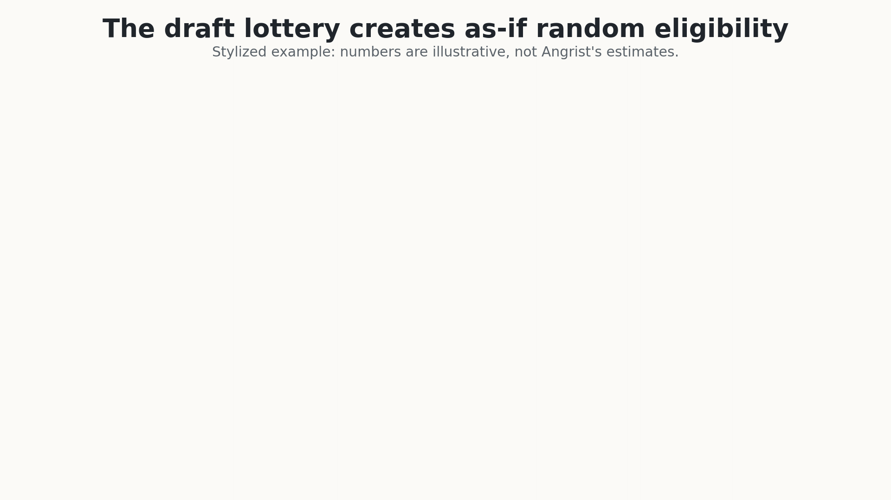
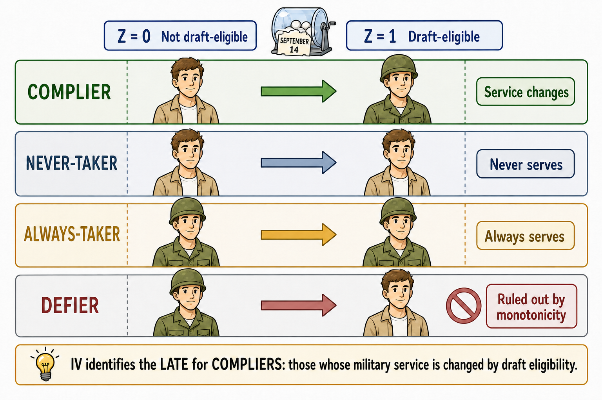

# Instrumental Variables

::: {.callout-note}
**IV in a figure**

:::

In observational studies, treated and untreated units often differ in ways that are not fully observed by the researcher. If unobserved factors influence both treatment participation and potential outcomes, the methods introduced in Section 5, such as matching and regression adjustment, will generally produce biased estimates of causal effects. This is because controlling for observed pre-treatment characteristics alone cannot eliminate selection bias arising from unobserved differences between treated and untreated units.

Suppose we want to estimate the effect of a treatment $D_i$ on a post-treatment outcome $Y_i$ using the linear model already presented in Chapter 5:

$$
Y_i = \alpha + \tau D_i + X_i'\beta + u_i.
$$

The problem is that, in many applications, $$\operatorname{Cov}(D_i,u_i) \neq 0.$$

This means that treatment status is correlated with unobserved determinants of the outcome. In this case, estimating $\tau$ by ordinary least squares does not generally yield an unbiased estimate of the causal effect of $D_i$ on $Y_i$.

For example, suppose we want to estimate the effect of obtaining a university degree on wages. University graduates tend to earn more than non-graduates, but they may also differ in unobserved characteristics such as ability, motivation, family background, or local employment opportunities. If these factors influence both the likelihood of obtaining a university degree and potential wages, the observed wage difference between graduates and non-graduates reflects not only the causal effect of education but also selection bias.

Instrumental variables (IV) provide a way to isolate a source of variation in treatment that is plausibly unrelated to these unobserved determinants of the outcome.

::: {.callout-note}
### IV in one sentence

A valid instrumental variable (IV) influences treatment participation but affects the outcome only through treatment.
:::

## Historical Intuition

An early and influential example of IV logic appears in Philip G. Wright's analysis of supply and demand in agricultural commodity markets [@wright1928]. Wright faced the challenge of estimating a demand curve when prices and quantities are jointly determined by supply and demand in market equilibrium. A simple regression of quantity on price cannot generally identify the demand curve because observed changes in prices and quantities reflect shifts in both supply and demand. As a result, the estimated relationship does not isolate how the quantity demanded responds to changes in price.

The key insight was to exploit variables that shift supply without directly shifting demand. Weather conditions, for example, may affect agricultural output and therefore supply, while leaving consumers' demand unchanged. These supply shifts generate changes in equilibrium prices that move the market along the demand curve, making it possible to estimate how quantity demanded responds to price. In modern terminology, weather-related supply shifters can therefore serve as **instruments** for price: they generate changes in price that originate from the supply side rather than from changes in consumers' demand. By isolating this source of price variation, we can study how quantity demanded responds to changes in price.

The Wright example captures the core logic of IV: when treatment is not randomly assigned and some confounders are unobserved, causal estimates from regression or matching methods are generally biased. A valid instrument provides a source of variation that affects treatment assignment but does not affect the outcome through any other channel. IV exploits this externally induced variation in treatment to estimate a causal effect.

## Example: College Proximity and Returns to Schooling

A classic example is Card's study of the returns to schooling [@card1993]. The question is: how much does an additional year of education increase future wages?

A simple comparison between more educated and less educated individuals may be biased because schooling is associated with unobserved ability and family background. Card uses geographic proximity to college as an instrument for educational attainment.

The identification argument has three components (see the next section for more details):

1. **Relevance:** individuals who grow up near a college face lower attendance costs, which may encourage them to obtain more schooling.
2. **Exclusion:** proximity to college must affect future wages only through schooling. For example, this assumption would be violated if living near a college also provided better employment opportunities or professional networks that increased wages independently of educational attainment.
3. **Exogeneity:** after conditioning on relevant pre-treatment covariates, proximity to college must be unrelated to factors that independently influence potential wages. For example, this assumption would be violated if families with greater unobserved resources, whose children would tend to earn more regardless of their education, systematically chose to live near colleges.

In this setting:

- $Z_i$ indicates whether an individual grew up near a college;
- $T_i$ denotes years of schooling;^[Unlike the binary treatment indicator $D_i$ used elsewhere in this chapter, $T_i$ measures treatment intensity: years of schooling. A binary instrument can shift a treatment that takes more than two values.]
- $Y_i$ denotes log wages;
- $X_i$ contains observed control variables.

Card reports IV estimates of the return to schooling that are roughly 25–60% higher than conventional OLS estimates across his specifications. He also finds that the educational gains associated with college proximity are concentrated among men from less-educated families, for whom nearby access is more likely to change educational attainment.

## The Basic IV Logic and the Key Assumptions

An instrument is usually denoted by $Z_i$. The core IV idea is that $Z_i$ affects treatment status $D_i$, and this instrument-induced variation in treatment is then used to learn about the effect of $D_i$ on the outcome $Y_i$:

$$
Z_i \rightarrow D_i \rightarrow Y_i.
$$

For this logic to identify a causal effect, the instrument must satisfy three conditions at the same time.

1. The instrument must affect the treatment. This is the **relevance condition**. After controlling for observed covariates $X_i$, the instrument must still be correlated with treatment status: $$\operatorname{Cov}(Z_i,D_i\mid X_i) \neq 0.$$ In practice, this means that changes in the instrument should generate changes in the probability of receiving the treatment, in the case of a binary treatment. Relevance is empirically assessable: we can estimate the first-stage relationship between $D_i$ and $Z_i$ (see next section) and check whether the instrument significantly predicts treatment even after controlling for $X_i$.

2. The instrument must affect the outcome **only through the treatment**. This is the **exclusion restriction**: changing $Z_i$ must not change $Y_i$ through any channel that bypasses $D_i$.

3. The instrument must also be **exogenous**: it must be unrelated to unobserved factors that influence potential outcomes, possibly after conditioning on relevant pre-treatment covariates. An instrument can satisfy the exclusion restriction but still violate exogeneity. For example, distance to college might affect wages only through education, yet remain correlated with family background if families with different resources systematically choose where to live.

To connect these assumptions to regression, recall the **linear outcome model**^[It is called an *outcome model* because it describes the outcome $Y_i$ as a function of treatment status $D_i$ and observed pre-treatment covariates $X_i$. The model is linear in these coefficients.] introduced at the beginning of the chapter:

$$
Y_i = \alpha + \tau D_i + X_i'\beta + u_i.
$$

For $Z_i$ to be a valid instrument in this model, it must be uncorrelated with the error term $u_i$, conditional on $X_i$:

$$
\operatorname{Cov}(Z_i,u_i\mid X_i)=0.
$$

This condition reflects both the **exclusion restriction** and **exogeneity**. It may be violated if the instrument affects the outcome through channels other than treatment or if it is correlated with unobserved factors that influence the outcome.

Unlike relevance, which can be assessed empirically, exclusion and exogeneity generally cannot be verified using observed data alone. Their credibility must therefore be supported by institutional knowledge, theory, and a convincing explanation of how the instrument is determined.

::: {.callout-caution}
### The exclusion restriction

The exclusion restriction is generally the most demanding IV assumption. Even a strong relationship between the instrument and treatment does not guarantee its validity. If the instrument affects the outcome through channels other than treatment, the exclusion restriction is violated, and the IV estimate cannot generally be interpreted as a causal effect.
:::

## Two-Stage Least Squares and the IV Ratio

The most common IV estimator is **two-stage least squares**, or **2SLS**. The name reflects the way the estimator isolates the part of treatment variation that is generated by the instrument.

In the first stage, the treatment is regressed on the instrument and the control variables:

$$
D_i =
\pi_0
+
\pi_1 Z_i
+
X_i'\pi
+
v_i.
$$

The coefficient $\pi_1$ measures the relationship between the instrument and treatment, after accounting for the control variables. This allows us to assess the relevance condition.

The regression then provides a fitted value for each unit:

$$
\widehat{D}_i
=
\widehat{\pi}_0
+
\widehat{\pi}_1 Z_i
+
X_i'\widehat{\pi}.
$$

This is the value of treatment predicted by the model using the unit's instrument and observed characteristics, rather than its actual treatment status. In other words, $\widehat{D}_i$ captures the part of treatment variation explained by these variables, excluding the unexplained component $v_i$.

In the second stage, the outcome is regressed on the predicted treatment and the control variables:

$$
Y_i =
\alpha
+
\tau_{\text{2SLS}} \widehat D_i
+
X_i'\beta
+
\varepsilon_i.
$$

The estimated coefficient $\widehat{\tau}_{\text{2SLS}}$ is the IV estimate obtained by 2SLS. The intuition is simple: rather than relying on all observed variation in treatment, 2SLS isolates the variation associated with the instrument, after accounting for the control variables. If the instrument is valid, this variation can be interpreted as exogenous^[In this context, **exogenous variation** means variation in treatment that is generated by the instrument rather than by factors that also affect the outcome. It can therefore be treated as unrelated to the unobserved determinants of the outcome.] and used to estimate a causal effect.

::: {.callout-warning appearance="simple"}
### Correct estimation of the standard errors

In practice, 2SLS should be estimated using an IV routine. It is not correct to manually run the two regressions and treat $\widehat D_i$ as if it were an ordinary observed variable, because standard errors must account for the generated regressor.
:::

::: {.callout-note appearance="simple"}
### Why two stages?

1. The first stage isolates the part of treatment explained by the instrument.  
2. The second stage relates the outcome to this instrument-induced variation in treatment.
:::

With a single instrument and a single treatment, the same idea can also be expressed as a ratio. The first stage measures how much the instrument changes the treatment, while the **reduced form** measures how much the instrument changes the outcome:

$$
Y_i
=
\rho_0
+
\rho_1 Z_i
+
X_i'\rho
+
e_i.
$$

Here, $\rho_1$ captures the effect of the instrument on the outcome, conditional on $X_i$. With a single instrument and a single treatment, the 2SLS estimate can equivalently be written as the ratio between the reduced-form effect and the first-stage effect:
  
  $$ \widehat{\tau}_{\text{2SLS}} = \frac{\widehat{\rho}_1}{\widehat{\pi}_1}. $$
    
This ratio asks: how much does the outcome change relative to the amount of treatment variation induced by the instrument?

## Example: Quarter of Birth and Education

Another famous IV example is Angrist and Krueger's study of compulsory schooling laws [@angrist1991]. They use quarter of birth as an instrument for years of schooling.

The argument is based on school-entry rules and compulsory attendance laws in the United States. Children born early in the year enter school at a slightly older age. Since students are allowed to leave school when they reach a certain age, those born later in the year may end up with slightly more schooling.

In this setting:

- $Z_i$ is quarter of birth;
- $D_i$ is years of schooling;
- $Y_i$ is wages.

The relevance condition requires that quarter of birth be associated with years of schooling. This relationship can be assessed in the first-stage regression. For example, individuals born in the last quarter of the year may complete slightly more schooling than those born earlier, because school-entry and compulsory-schooling rules can make the age at which students are allowed to leave school depend on their quarter of birth.

The exclusion restriction requires that quarter of birth affect wages only through schooling. Unlike relevance, which can be assessed empirically, this assumption is more difficult to justify because we cannot directly rule out other channels through which birth timing might influence wages. For example, quarter of birth could affect wages through differences in early-life health or age relative to classmates, independently of years of schooling. Separately, exogeneity requires that quarter of birth be unrelated to unobserved determinants of wages, such as family background or ability.

The IV estimate can be obtained by dividing the effect of quarter of birth on wages by its effect on schooling. For example, suppose that being born in the last quarter increases schooling by 0.10 years and wages by 0.86%. The implied IV estimate is approximately

$$
\frac{0.86\%}{0.10}=8.6\%.
$$

This suggests that an additional year of schooling increases wages by approximately 8.6% for individuals whose educational attainment is influenced by quarter of birth, provided the IV assumptions hold.

## Weak Instruments

A major practical concern in IV estimation is the problem of **weak instruments**. An instrument is weak when it has limited ability to explain variation in treatment, after accounting for the control variables.

Weak instruments are problematic because 2SLS uses the variation in treatment predicted by the instrument. If the instrument barely influences treatment, the predicted treatment contains little useful variation. As a result, the IV estimator becomes unstable and can have poor finite-sample properties.^[*Finite-sample properties* describe how an estimator behaves when the number of observations is limited, rather than when the sample size approaches infinity. In small samples, weak instruments can produce biased estimates, large variability, and confidence intervals that do not achieve their intended coverage probabilities.]

Work by Bound, Jaeger, and Baker [-@bound1995] showed that weak instruments can make IV estimates and standard errors misleading, even in large samples. When instruments are weak:

- 2SLS estimates can be biased toward OLS in finite samples;
- confidence intervals may be unreliable;

- conventional t-tests may reject too often;^[*Conventional t-tests* assess whether an estimated coefficient is statistically different from zero by dividing the estimate by its standard error. With weak instruments, the usual statistical approximations may be unreliable, causing these tests to reject a true null hypothesis more frequently than the chosen significance level would suggest.]
- small violations of the exclusion restriction can be amplified.

::: {.callout-caution}
### Weak instruments

Even an instrument that satisfies the exclusion and exogeneity assumptions can be problematic if it has only a weak relationship with treatment. When the instrument barely influences treatment, IV estimates may be imprecise, biased, and misleading.
:::

A standard diagnostic is the first-stage F-statistic.^[The *first-stage F-statistic* measures how strongly the instrument (or instruments) explains variation in treatment after accounting for the control variables. It tests whether the instruments jointly contribute to explaining treatment. Higher values indicate a stronger statistical relationship between the instruments and treatment, while low values suggest that the instruments provide little additional explanatory power.] A low first-stage F-statistic is a warning sign that the instrument may be weak. However, recent work emphasizes that conventional diagnostics can be misleading if standard errors are not adjusted correctly for heteroskedasticity, clustering, or serial correlation [@montielolea2013; @lal2024].

## Binary Instruments and LATE

When the instrument is binary, IV estimates are often interpreted as **local average treatment effect (LATE)** estimates.

Suppose $Z_i$ takes two values: $Z_i=1$ and $Z_i=0$. To describe the LATE interpretation, it is useful to define two potential treatment statuses:

$$
D_i(1)
\quad \text{and} \quad
D_i(0),
$$

where $D_i(1)$ is the treatment status that unit $i$ would have if exposed to the instrument, $Z_i=1$, and $D_i(0)$ is the treatment status that the same unit would have if not exposed to the instrument, $Z_i=0$. Units can then be classified according to how their treatment status responds to the instrument.

There are four types of units (see @angrist1996iv):

| Type | $D_i(0)$ | $D_i(1)$ | Interpretation |
|---|:---:|:---:|---|
| **Compliers** | 0 | 1 | They receive treatment when the instrument equals 1, but not when it equals 0. |
| **Never-takers** | 0 | 0 | They never receive treatment, regardless of the instrument's value. |
| **Always-takers** | 1 | 1 | They take the treatment, regardless of the instrument's value. |
| **Defiers** | 1 | 0 | They receive treatment when the instrument equals 0, but not when it equals 1. |

Under the *LATE assumptions* (see below), IV identifies the average causal effect for compliers: individuals who receive treatment when the instrument equals 1 but would not receive it when the instrument equals 0. This distinction matters because IV does not generally identify the ATT, which concerns all treated units, but rather the average effect for this specific subgroup.

If treatment effects are heterogeneous, different instruments can produce different estimates because they identify effects for different complier groups.

::: {.callout-note}
### Who are the compliers?

Compliers are units who receive treatment when the instrument equals 1 but would not receive it when the instrument equals 0. Different instruments may influence the treatment decisions of different groups of units and therefore identify different LATEs.
:::

### The Identification Assumptions with a binary instrument

For a binary instrument and a binary treatment, the LATE interpretation requires four main assumptions.

1. **Exogeneity:** The instrument must be as good as randomly assigned, possibly after conditioning on pre-treatment covariates. This means that it must be independent of the units' potential outcomes and potential treatment statuses, namely whether they would receive treatment under each possible value of the instrument.

2. **Exclusion restriction:** The instrument must affect the outcome only through treatment. In other words, changing the instrument's value while keeping treatment status fixed must not change the outcome.

3. **Relevance:** The instrument must influence the probability of receiving treatment, even after accounting for pre-treatment covariates. This means that changing the instrument's value must affect treatment participation for at least some units.

4. **Monotonicity:** Increasing the instrument from 0 to 1 must not cause any unit to switch from receiving treatment to not receiving it. Some units may remain unaffected, but those whose treatment status changes must all respond in the same direction. In other words, there must be no **defiers**.

When the instrument is as good as randomly assigned without conditioning on covariates, these assumptions identify the LATE through the unconditional Wald ratio:

$$
LATE
=
E[Y_i(1)-Y_i(0)\mid D_i(1)>D_i(0)]
=
\frac{
E[Y_i^{obs}\mid Z_i=1] - E[Y_i^{obs}\mid Z_i=0]
}{
E[D_i\mid Z_i=1] - E[D_i\mid Z_i=0]
}.
$$

The numerator is the reduced-form effect of the instrument on the outcome. The denominator is the first-stage effect of the instrument on treatment. **Intuitively, the ratio scales the change in the outcome caused by the instrument by the change in treatment participation caused by the instrument.** It therefore asks how much the outcome changes for each additional unit induced into treatment by the instrument. For example, if the instrument increases the outcome by 2 units and raises the probability of treatment by 0.25, the implied LATE is $2/0.25=8$.

If the instrument is as good as randomly assigned only after conditioning on pre-treatment covariates $X_i$, the unconditional Wald ratio does not generally identify the LATE. Instead, we must compare outcomes and treatment participation between instrument groups with the same covariate values. For each covariate profile where the instrument influences treatment participation, the ratio of these conditional differences identifies the LATE for compliers with those characteristics. To obtain an overall LATE, these effects must be aggregated using weights that reflect the relative number of compliers in each covariate group.

### Example: Vietnam Draft Lottery

::: {.content-visible when-format="html"}

:::

A classic example with a binary instrument is Angrist's study of the effect of military service on later earnings [@angrist1990]. During the Vietnam War, the United States used a draft lottery to determine the order in which young men could be called for military service. Each calendar date was randomly assigned a lottery number, and men born on that date received the corresponding number. For example, imagine that June 10 was assigned number 25 and June 11 number 275. A man born on June 10 would face a much higher probability of being drafted than someone born just one day later. The key point is that lottery numbers were assigned randomly, creating differences in draft eligibility unrelated to individual characteristics. However, receiving a low lottery number did not automatically mean serving in the military, since exemptions and other eligibility criteria also mattered.

The draft lottery can be interpreted as an instrument for military service:

- $Z_i$ is draft eligibility;
- $D_i$ is military service;
- $Y_i$ is later earnings.

Not everyone who was draft-eligible served in the military, while some individuals who were not draft-eligible still served, for example by volunteering. The draft lottery therefore influenced the probability of military service without fully determining it. Under the monotonicity assumption, the population can be divided into three groups: **compliers**, who serve only if draft-eligible; **always-takers**, who serve regardless of eligibility; and **never-takers**, who do not serve regardless of eligibility.

The IV estimate identifies the average effect of military service for compliers, namely individuals whose decision to serve was influenced by their draft eligibility. Angrist finds that military service reduced subsequent earnings by approximately 15% among white veterans.

::: {.callout-note}
### Binary versus continuous instruments: what changes?

An instrumental variable can be either **binary** or **continuous**. To understand the difference, suppose we want to estimate the causal effect of obtaining a university degree on future earnings, using proximity to a university as an instrument. The treatment is binary: individuals either obtain a degree or do not.

**Binary instrument.** Suppose proximity is measured by an indicator equal to 1 for individuals living within 20 km of a university and 0 for those living farther away. The instrument divides individuals into two groups. Under the LATE assumptions, IV identifies the average effect of obtaining a degree for **compliers**: individuals who would obtain a degree if they lived near a university but would not obtain one if they lived farther away.

**Continuous instrument.** Now suppose proximity is measured by the distance to the nearest university in kilometers. The instrument can take many values, rather than just 0 or 1. This allows the analysis to exploit differences in distance across individuals, but makes the interpretation of the IV estimate more complex.

For example, moving from 5 to 10 kilometers away from a university may affect the decision to obtain a degree for some individuals, while moving from 30 to 35 kilometers may affect others. Consequently, the IV estimate may combine treatment effects for different groups of individuals whose educational decisions respond to different changes in distance.

**The key difference** is that a binary instrument compares two values of the instrument and identifies a LATE for the corresponding compliers. A continuous instrument exploits variation across multiple values and may identify a weighted average of effects for individuals whose treatment decisions respond to different changes in the instrument.
:::

## Interpreting IV Estimates

Interpreting IV estimates requires care. Each IV estimate depends on the instrument, because the instrument determines which units are shifted into treatment.

For example, college proximity may identify the return to schooling for individuals whose education decisions are affected by geographic access to college. Quarter of birth may identify the return to schooling for individuals whose schooling is affected by compulsory schooling laws. These are not necessarily the same people.

This means that IV estimates should not automatically be interpreted as average effects for everyone. They generally retrieve average causal effects only for the units affected by the instrument.

A limitation of the IV interpretation is that we usually do not know exactly **for whom** the causal effect is being estimated. Although IV identifies the average effect for compliers, we cannot directly observe which individuals would change their treatment status in response to the instrument. The LATE therefore refers to a **latent subpopulation**.^[In statistics, **latent** refers to something that cannot be directly observed but can be inferred indirectly from observed data and appropriate assumptions. Here, we cannot determine whether a particular individual is a complier because we observe their treatment decision under only one value of the instrument, not both.] In some applications, researchers can describe the average characteristics of compliers, such as their socioeconomic background or geographic location. However, this does not eliminate the underlying limitation: the estimated causal effect applies to a subgroup whose individual members cannot generally be identified.

::: {.callout-warning}
### Multiple instruments and interpretation

Using more than one instrument can improve predictive power, but it also introduces additional challenges for causal identification and interpretation.

First, **exclusion and exogeneity must hold for every instrument**. Adding instruments therefore introduces additional assumptions that researchers must justify. Even if some instruments are valid, including an instrument that affects the outcome through other channels or is correlated with unobserved outcome determinants can bias the IV estimate.

Second, different instruments may influence treatment participation for different groups of compliers. When treatment effects are heterogeneous, combining multiple instruments may therefore produce an estimate that reflects different local treatment effects, with weights that are not always straightforward to interpret.

For these reasons, a stronger relationship between instruments and treatment is not sufficient to justify their use. Researchers should carefully assess the credibility of each instrument, explain which sources of variation identify the causal effect, and clarify the interpretation of the resulting estimate.
:::

## Practical Concerns in Applied IV Work

Recent replication evidence raises concerns about how IV is used in practice. Lal et al. [-@lal2024] replicate a set of recent political science papers using IV strategies and identify several recurring problems.

1. Some applications overstate instrument strength because first-stage diagnostics do not properly adjust standard errors for heteroskedasticity, serial correlation, or clustering.

2. Conventional t-tests based on 2SLS standard errors may understate uncertainty when instruments are weak.

3. IV estimates are often much larger than OLS estimates, especially when the first stage is weak. This pattern can be a warning sign of weak instruments, violations of the exclusion restriction, or both.

Another concern is the interpretation of IV estimates when treatment effects are heterogeneous. Mogstad and Torgovitsky [-@mogstad2024iv] emphasize that **treatment effects may differ across individuals in ways that researchers cannot fully observe**. In such settings, linear IV estimators do not generally identify the average treatment effect for the entire population. Instead, under appropriate assumptions, they identify a local or weighted average of treatment effects, giving particular importance to individuals whose treatment decisions respond to the instrument. The interpretation therefore depends on which individuals are influenced by the instrument and how their effects are weighted.

These concerns do not imply that IV should not be used. Rather, they reinforce the need for careful design, transparent reporting, and sensitivity analysis. Applied IV work should report instrument strength, use inference procedures that are robust to weak instruments when needed, justify the exclusion restriction, and be explicit about the population and causal parameter to which the IV estimate refers.

::: {.callout-note appearance="simple"}
### Shift-share instruments

A common IV strategy is based on **shift-share variation**, also known as a **Bartik instrument** [@bartik1991; @goldsmithpinkham2020]. The idea is to combine pre-existing local exposure shares with aggregate shocks that are plausibly external to the local unit.

For example, suppose we want to estimate the effect of immigration on local wages. A shift-share instrument may predict immigration inflows into a city by combining the city’s historical immigrant composition with national inflows from each origin country. Cities that historically hosted more immigrants from countries experiencing larger national inflows are predicted to receive more immigrants.

The IV logic is that the predicted treatment variation comes from two components: predetermined local shares and external shocks. If the shocks are plausibly exogenous, and if the historical shares affect the outcome only through the treatment channel of interest, the shift-share variable can be used as an instrument.

However, the strategy requires care. Historical shares may be related to long-run local trends, and aggregate shocks may affect outcomes through channels other than the treatment. As in any IV design, the key questions are: what generates the variation in the instrument, why is it relevant, and why should it affect the outcome only through the treatment?
:::

::: {.callout-note appearance="simple"}
### Beyond LATE: the marginal treatment effect (MTE)

The **marginal treatment effect (MTE)** is another causal estimand that provides a more detailed view of treatment-effect heterogeneity within an IV framework [@heckman1999liv; @heckman2005mte]. Unlike the ATE, ATT, and LATE introduced earlier, the MTE focuses on individuals with a given level of **unobserved resistance to treatment**, reflecting factors such as preferences or perceived participation costs. The treatment itself remains binary.

Intuitively, the MTE measures the average causal effect for individuals who would enter treatment in response to a very small increase in the probability of participation.

For example, suppose a valid instrument increases the probability of attending college from 40% to 41%. The corresponding LATE measures the average effect for individuals induced to attend by this change. As the increase becomes arbitrarily small, this average approaches the MTE at that participation margin. Individuals induced to attend at other margins may experience different treatment effects.

Under the standard monotone selection model, **LATE can be interpreted as a weighted average of MTEs across the participation margins affected by the instrument**. If the MTE can be identified across the relevant range of unobserved resistance to treatment, it can be aggregated to recover broader causal estimands, such as the ATE and ATT.

However, a single binary instrument generally identifies only an average across a range of participation margins, rather than the MTE at each margin. Identifying MTEs across a wider range requires sufficiently rich variation in participation probabilities and additional strong assumptions.
:::

## Summary

IV estimates causal effects using variation in treatment induced by an instrument that affects the outcome only through treatment and satisfies the other identifying assumptions.

The **2SLS estimator** implements this approach by first predicting treatment using the instrument and then using these predicted values to estimate its effect on the outcome.

With binary instruments and treatments, IV identifies the **LATE for compliers** under the appropriate assumptions. More generally, its causal interpretation depends on which units respond to the instrument and how their treatment changes.

Let me conclude by stressing that a valid instrument must satisfy the **exclusion restriction**: it must affect the outcome only through treatment. In practice, this condition is often difficult to justify, as variables that influence treatment may also affect outcomes through other channels. Researchers should therefore carefully examine these alternative explanations and provide convincing theoretical and institutional arguments for the exclusion restriction, rather than relying solely on the instrument's ability to predict treatment.

::: {.callout-note appearance="simple"}
## Software packages

Several software packages can be used to estimate instrumental-variables models, usually through two-stage least squares (2SLS), limited-information maximum likelihood (LIML), or related GMM estimators.

- **R**
  - [`ivreg`](https://cran.r-project.org/package=ivreg): a dedicated package for instrumental-variables regression, with 2SLS estimation and diagnostic tools.
  - [`fixest`](https://lrberge.github.io/fixest/reference/feols.html): supports IV estimation with high-dimensional fixed effects through `feols()`.
  - [`estimatr`](https://search.r-project.org/CRAN/refmans/estimatr/help/iv_robust.html): provides `iv_robust()` for 2SLS with robust and clustered standard errors.

- **Python**
  - [`linearmodels`](https://bashtage.github.io/linearmodels/iv/iv/linearmodels.iv.model.IV2SLS.html): includes IV estimators such as 2SLS, LIML, GMM, and continuously updated GMM.
  - [`pyfixest`](https://pyfixest.org/quickstart.html): supports IV estimation with syntax inspired by the R package `fixest`.

- **Stata**
  - [`ivregress`](https://www.stata.com/manuals/rivregress.pdf): official Stata command for single-equation IV regression, including 2SLS, LIML, and GMM.
  - [`ivreg2`](https://ideas.repec.org/c/boc/bocode/s425401.html): widely used user-written command with extensive diagnostics for IV estimation.
  - [`weakiv`](https://ideas.repec.org/c/boc/bocode/s457684.html): weak-instrument-robust tests for IV models.
:::
